<p align="center">
  <picture>
    <source media="(prefers-color-scheme: dark)" srcset="docs/logo/simar-ui-sans-dark.svg">
    
  </picture>
</p>

# simar-ui v1 beta


**A dependency-free, accessible UI library built on native HTML.** Forms, navigation, data display, feedback and layout: nearly forty components, each one a real HTML element underneath (`<button>`, `<input>`, `<dialog>`, `<table>`, `<details>`), with the styling, the keyboard behavior and the ARIA on top. You configure them with HTML attributes, they work without JavaScript, they follow light and dark, and they are built to meet WCAG 2.2 AA. The aim is that you never need another library for a component.

<picture>
  <source media="(prefers-color-scheme: dark)" srcset="docs/screenshots/hero-dark.png">
  
</picture>

**Free and open source.** simar-ui is public and MIT licensed: use it in personal and commercial projects, change it, and ship it, no strings attached.

## Why simar-ui

- **Native first.** The browser does the work: forms, labels, validation, focus, the keyboard and screen-reader behavior all come from the real element. Where no native element exists (tabs, menus, a combobox), it follows the matching WAI-ARIA pattern exactly. The script only enhances, so a component still works when it doesn't run.
- **Tokens all the way down.** Shape, depth, color and type are CSS custom properties, and you choose how fine-grained to be. Global tokens (`--radius`, `--depth`, `--fade`, `--lit`) move everything together; every component also has its own (`--key-radius`, `--card-radius`) that falls back to the global one. Nine ready-made styles (`data-style`) bundle them, from `basic` (plain, flat HTML) to `brutal`, and each works in light and dark, with every palette and highlight. [More below.](#styles-and-design-tokens)
- **Accessible, and kept that way.** Keyboard operable, WCAG 2.2 AA contrast (gradients, disabled controls and chart colors included), 24px targets, no dragging required, reduced motion and forced colors supported. Axe, contrast, keyboard and WCAG 2.2 checks run over the demo in light and dark, in every style, and the library warns you while you build if you forget a label. It says plainly what automation cannot confirm. [More below.](#accessibility)
- **Small.** About 44 KB gzipped for the CSS, the script and the icons together. Charts are an optional add-on (1.4 KB plus [Chartist](https://chartist.dev)), and nothing else is downloaded unless you choose a web font.
- **Works without JavaScript.** Native controls, content stacked in order, forms that submit. Newer CSS is guarded and falls back to the browser's defaults.
- **Configured in HTML.** Options are attributes (`min`, `max`, `step`, `data-lit="blue"`, `data-style="soft"`), or short tags like `<simar-knob label="Volume" max="11">`. No config objects, and it sits alongside any framework because it is just markup.
- **Responsive.** Mobile first, with Bootstrap-style breakpoints, a grid and display helpers; nothing scrolls sideways at 320px.

## Install

**From a CDN** (two lines):

```html
<link rel="stylesheet" href="https://cdn.jsdelivr.net/gh/roboteight/simar-ui@1/dist/simar-ui.min.css">
<script src="https://cdn.jsdelivr.net/gh/roboteight/simar-ui@1/dist/simar-ui.min.js" defer></script>
```

**With npm:**

```sh
npm install simar-ui
```

```js
import 'simar-ui/css';
import 'simar-ui'; // starts itself
```

**Or copy the files:** `dist/simar-ui.min.css` and `dist/simar-ui.min.js`.

The script injects its own icons. To have icons also show with JavaScript off, paste `dist/simar-ui-icons.svg` into the page once, just inside `<body>`.

## Use it

Write the native markup, or use short tags that expand into it:

```html
<simar-fader label="Brightness" name="brightness" min="0" max="100" value="40" unit="%"></simar-fader>
<simar-knob label="Tone" name="tone" max="3" step="1" labels="Flat,Warm,Bright,Punch"></simar-knob>
<simar-date-range name="stay" from="2026-11-02" to="2026-11-09" months="2"></simar-date-range>
```

The tags are replaced with real inputs, so values submit with their form and `input` / `change` events work as usual. Tags need JavaScript; the native markup doesn't. For markup added after page load, call `SimarUI.init(element)`.

Open `index.html` for the live demo: a contents list that floats on the left (below 75rem it folds into a side menu on the left edge), a sticky header with in-page search (Ctrl or Cmd + K) and an Appearance dropdown (Auto, Light, Dark), and a settings side menu on the right edge that appears once you scroll past Page settings. Every component has an **HTML** key that shows exactly how it was added to the page, with the tag form and JavaScript examples.

## What's inside

**Content:** card, carousel and gallery, code, divider, embed, layout and breakpoints, lists, media, quotes, text blurbs, timeline, typography. **Forms:** check list, checkboxes and switches, datalist and autocomplete, date range, form control, input group, knobs, radio buttons, range pickers, select, validation. **Components:** accordion, alerts and toasts, app bars, badge, breadcrumb, button group, buttons, charts (an optional add-on), confirmation dialog, dialog, dropdown menu, floating button, map (an optional add-on), meter, pagination, progress, side menu, spinners, table, tabs, tooltips. **Customize:** design tokens, styles, themes, fonts, highlight colors, configuration.

The demo page, its contents list and this README share one order: Getting started, then Customize, then Content, Forms and Components, each of those three alphabetical (a few close relatives, such as Button group beside Buttons, happen to fall together).

### Content

#### Card

A self-contained block: an `<article>` with an optional image, a heading and words, and a footer for actions. Every part is optional. Lay cards in a `blurb-grid` and they wrap to fit. To make the whole card a link, put one `<a class="card__link">` inside the heading: a click anywhere follows it, while a keyboard and a screen reader meet a single link named by the heading. Buttons and links in the footer stay separate.

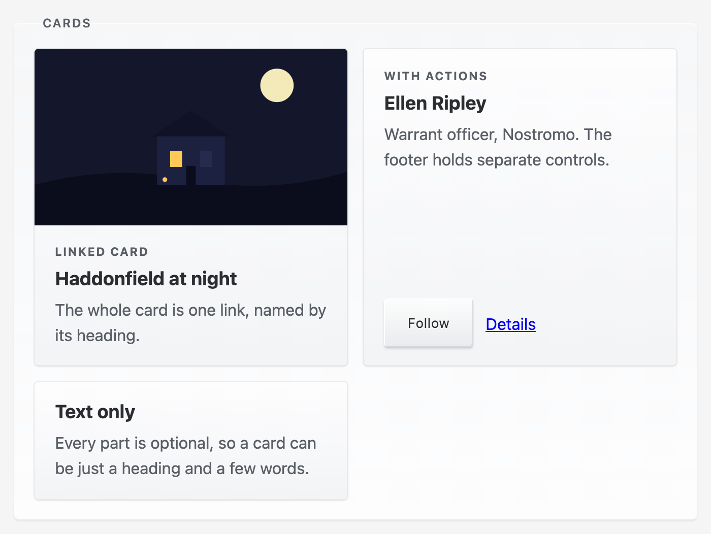

```html
<article class="card">
  
  <div class="card__body">
    <h4 class="card__title"><a class="card__link" href="/laurie">Laurie Strode</a></h4>
    <p class="card__text">A few words.</p>
  </div>
</article>
```

#### Carousel and gallery

A row of slides that scrolls sideways and snaps, built on plain HTML and CSS so it works without script: swipe it, focus it and use the arrow keys, or follow the numbered links (each points at a slide's `id`, so the browser scrolls to it). Script adds only the extras: Previous and Next keys (they wrap round), Home and End on the focused row (on a plain row they scroll the page, not the slides), `aria-current` on the link of the slide in view, and a polite "Slide 2 of 4" status that speaks only when the person moves.

It follows the WAI-ARIA *Carousel* pattern: a region with `aria-roledescription="carousel"` and a name, a focusable named row, and each slide a group named "1 of 4". Use a `media` figure for each picture, with real alt text. Nothing moves by itself. `data-autoplay="4000"` (milliseconds, 3000 or more) turns on auto-play, and then there is always a Pause key (it reads "Play slides" once paused), it stops while the pointer or keyboard focus is inside, it never announces itself, and it does not start at all for visitors who asked for reduced motion (WCAG 2.2.2). Add `carousel--multi` for a gallery that shows one slide on a phone, two from sm and three from lg. Tokens: `--carousel-gap`, `--carousel-per`.

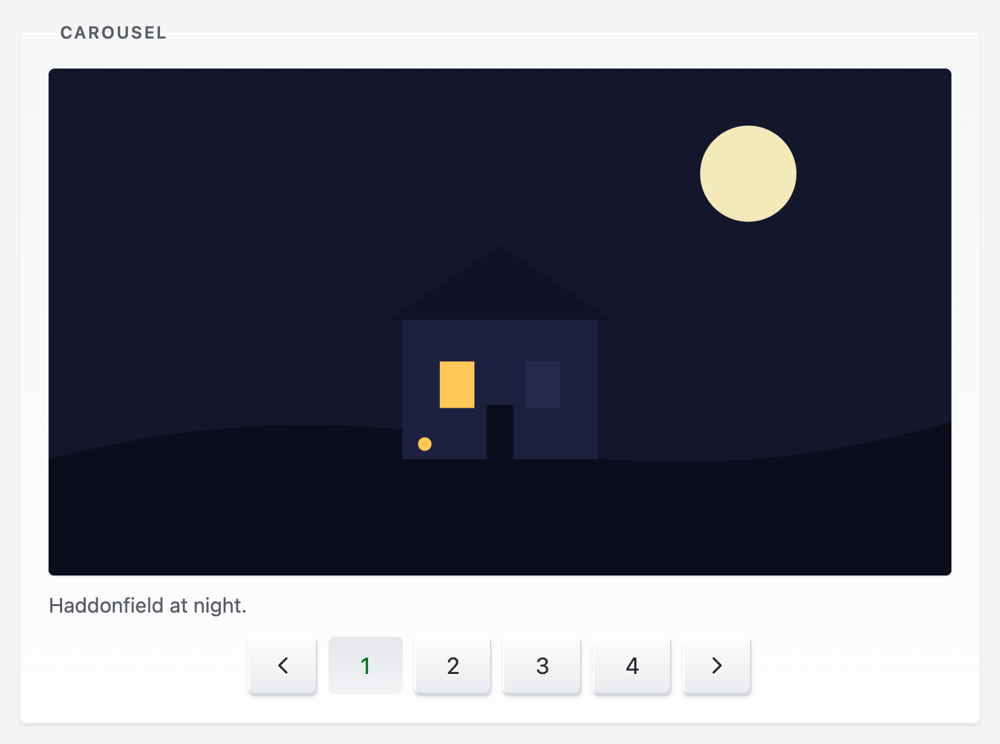
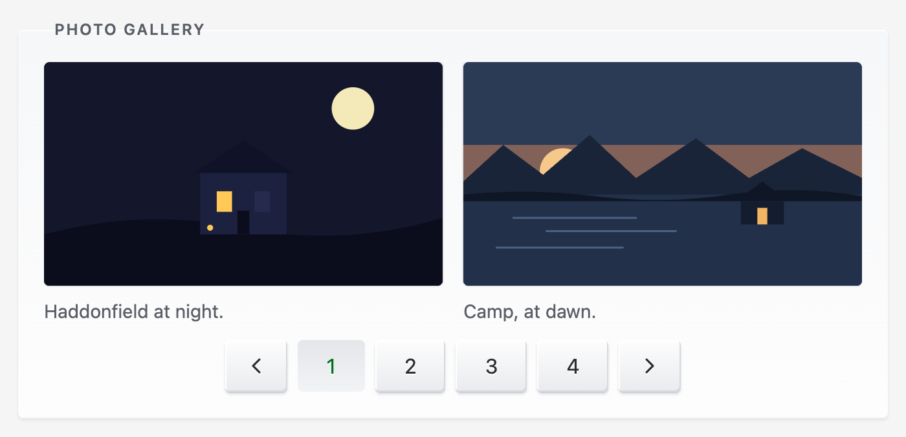

```html
<section class="carousel" aria-roledescription="carousel" aria-label="Venues">
  <div class="carousel__track" tabindex="0" role="group" aria-label="Venue photos">
    <div class="carousel__slide" id="v1" role="group" aria-roledescription="slide" aria-label="1 of 2">
      <figure class="media media--16x9">
        
        <figcaption>The club, before doors.</figcaption>
      </figure>
    </div>
    <div class="carousel__slide" id="v2" role="group" aria-roledescription="slide" aria-label="2 of 2"> … </div>
  </div>
  <div class="carousel__bar">
    <nav class="carousel__nav" aria-label="Choose a slide"><ol>
      <li><a class="key" href="#v1"><span class="visually-hidden">Slide </span>1</a></li>
      <li><a class="key" href="#v2"><span class="visually-hidden">Slide </span>2</a></li>
    </ol></nav>
  </div>
</section>
```

#### Code

A terminal-style block: monospace text on a dark screen, with a title bar when it has a label, with line numbers and a copy button. The numbers are skipped by screen readers and aren't copied; the block can be scrolled by keyboard.


```html
<simar-code lang="html"><template><button class="key">Push</button></template></simar-code>
```

#### Divider

A standalone `<hr>`: a thin line that marks a change of topic. Add `divider` (inside `.prose` a plain `<hr>` gets the same look). It is a real thematic break, so a screen reader can announce it.

```html
<hr class="divider">
```

#### Embed

A responsive frame for content you don't control the size of: an `<iframe>` (a map, a video player, a document), an `<embed>`, an `<object>`, a `<canvas>` or a `<video>`. It keeps an aspect ratio (16:9, or `embed--4x3`, `embed--1x1`, `embed--21x9`, or any ratio with `--embed-ratio`) and scales with its container, so it never overflows a phone. An `<iframe>` must have a `title`, which is its name for a screen reader. When keyboard focus moves into the frame the embed draws a focus ring (the page's own CSS can't see focus inside a frame, so the script marks it).

```html
<div class="embed embed--4x3">
  <iframe src="https://example.com/player" title="Ramones at CBGB, 1977" loading="lazy"></iframe>
</div>
```

#### Layout and breakpoints

Responsive behavior borrowed from [Bootstrap](https://getbootstrap.com/docs/5.3/layout/grid/): a `container`, a 12-column `row` of `col-*` items, and `d-*` display helpers that change at five mobile-first breakpoints (`sm` 36rem, `md` 48rem, `lg` 62rem, `xl` 75rem, `xxl` 87.5rem, in `rem` so they follow the reader's text size). The class names will be familiar; the code is our own, and uses CSS grid.

```html
<div class="container">
  <div class="row">
    <div class="col-12 col-md-6 col-lg-4">One</div>
    <div class="col-12 col-md-6 col-lg-4">Two</div>
    <div class="col-12 col-lg-4">Three</div>
  </div>
</div>
<span class="d-md-none">Shown below md</span>
```

#### Lists

Native `<ul>`, `<ol>` and `<dl>`, styled. A bare list is left to the browser, so add `list`. The markers take the theme's highlight color and nested lists indent. A description list puts each term beside its detail (`list--stacked` puts the detail underneath, and on a phone they stack). `list--divided` draws a line between items, like a list group. `list--plain` drops the markers; give a plain or divided list `role="list"`, because Safari with VoiceOver stops announcing a list once its markers are gone. Tokens: `--list-gap`, `--list-marker`.

```html
<ul class="list"><li>Joey Ramone</li><li>Dee Dee Ramone</li></ul>

<ul class="list list--divided" role="list"><li>Ellen Ripley</li><li>Laurie Strode</li></ul>

<dl class="list"><dt>Band</dt><dd>Black Flag</dd><dt>Singer</dt><dd>Henry Rollins</dd></dl>
```

#### Media

Images, video and audio on the native elements. Put `media` on a `<figure>` and its picture scales down to fit, keeps its shape and gets the same rim as other surfaces; `media--16x9`, `media--4x3` and `media--1x1` crop to a fixed shape. Give every image its `width` and `height` (so the page doesn't jump while it loads) and an `alt` that says what it shows. Video and audio keep the browser's own controls, which a keyboard and screen reader can use; the library does not add captions, so supply a `<track>` or a transcript for any recording.

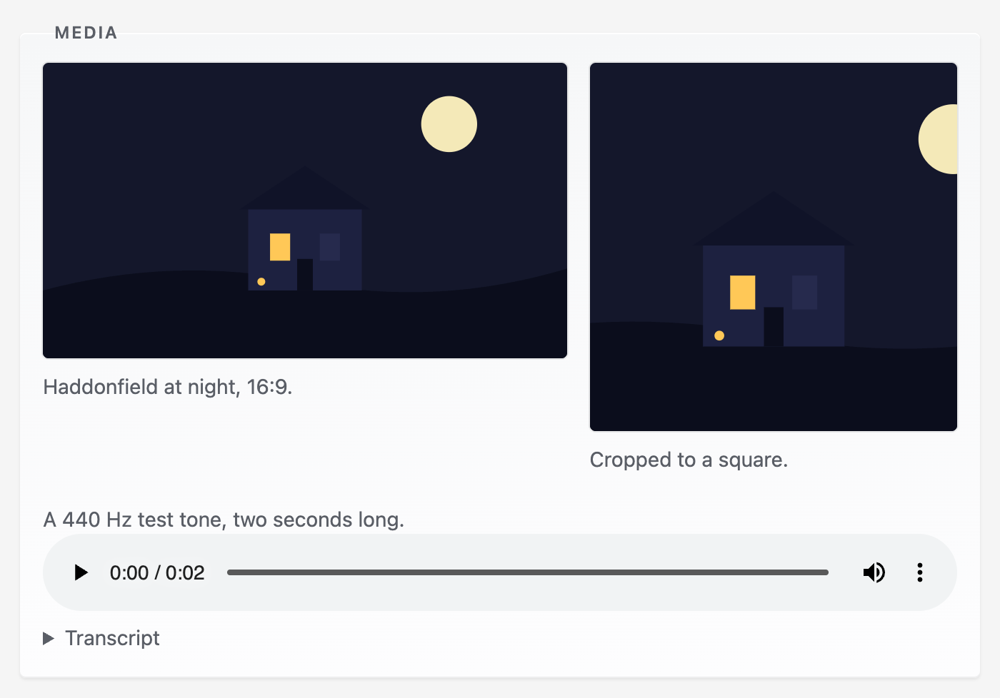

```html
<figure class="media media--16x9">
  
  <figcaption>Blondie at CBGB, 1977.</figcaption>
</figure>
```

#### Quotes

A `<blockquote>` in a `<figure class="quote">`, with who said it in the `<figcaption>`. Add `quote--pull` for a pull quote.

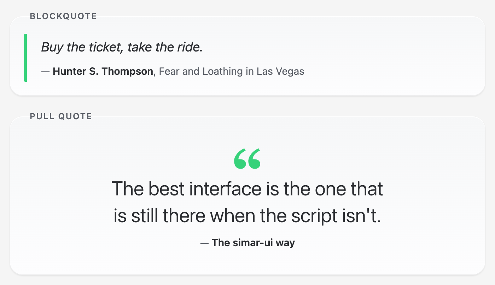

```html
<figure class="quote">
  <blockquote><p>Buy the ticket, take the ride.</p></blockquote>
  <figcaption><cite>Hunter S. Thompson</cite>, Fear and Loathing in Las Vegas</figcaption>
</figure>
```

#### Text blurbs

A short block with a small label, a title and a few words. Put several in a `blurb-grid` and they wrap to fit the window; `blurb--inset` sinks one into the page.

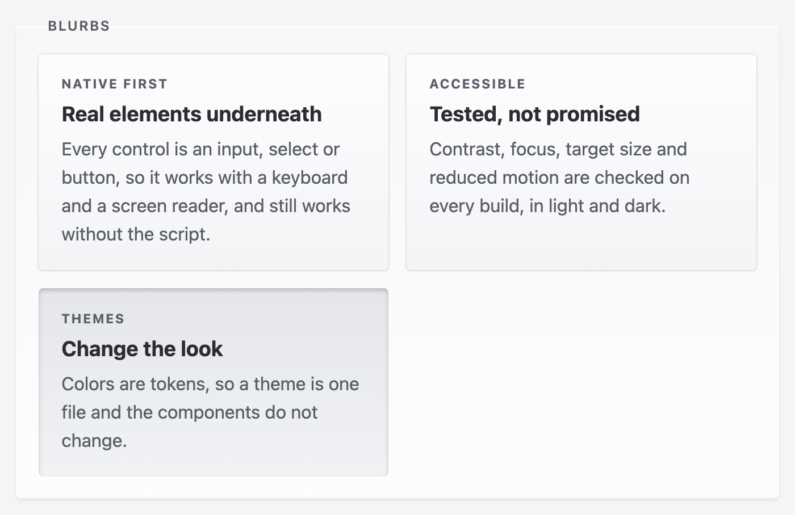

#### Timeline

Events or steps in order, as a native `<ol>`, so a screen reader says how many there are. Each entry has a dot on a thin rail, in the style of the depth rail on the case studies at chrissimari.com. The state is in the shape of the dot, not only its color: a filled dot is done, a glowing ring (`aria-current="step"`) is now, and a hollow ring (`timeline__item--upcoming`) is still to come. It is vertical by default; `timeline--horizontal` runs it left to right from the md breakpoint up and stacks on a phone, so it never needs sideways scrolling. Tokens: `--timeline-dot`, `--timeline-rail`, `--timeline-gap`.

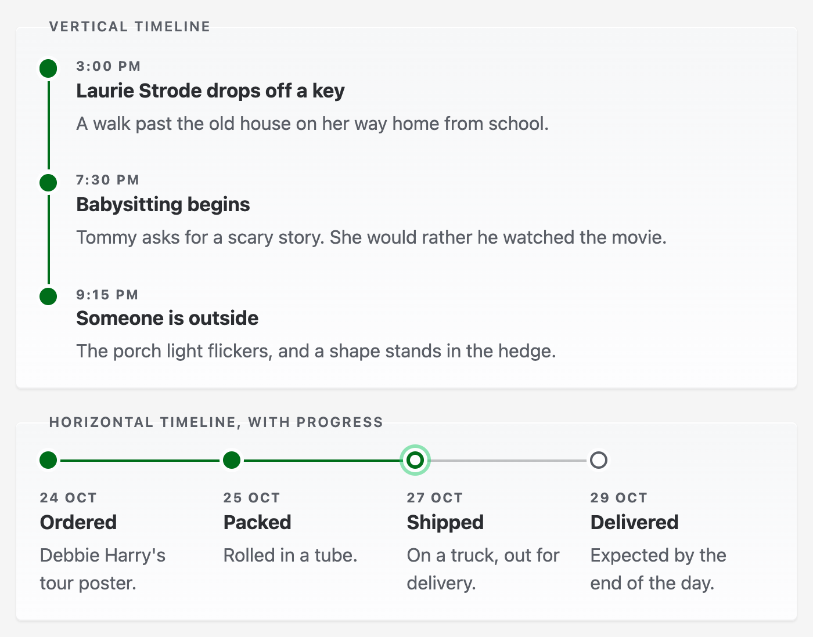

```html
<ol class="timeline timeline--horizontal" aria-label="Delivery">
  <li class="timeline__item">
    <time class="timeline__time" datetime="2026-10-24">24 Oct</time>
    <h4 class="timeline__title">Ordered <span class="visually-hidden">(completed)</span></h4>
  </li>
  <li class="timeline__item" aria-current="step">
    <time class="timeline__time" datetime="2026-10-27">27 Oct</time>
    <h4 class="timeline__title">Shipped <span class="visually-hidden">(current step)</span></h4>
  </li>
  <li class="timeline__item timeline__item--upcoming">
    <time class="timeline__time" datetime="2026-10-29">29 Oct</time>
    <h4 class="timeline__title">Delivered <span class="visually-hidden">(upcoming)</span></h4>
  </li>
</ol>
```

#### Typography

Headings, display type, a lead paragraph and running text. Use the classes anywhere (`.h1` to `.h6`, `.display-1` to `.display-3`, `.lead`), or wrap text in `.prose` to style the plain elements inside it (links, lists, `mark`, `kbd`, `abbr`, `hr`). Sizes scale with the window, so they fit a phone.

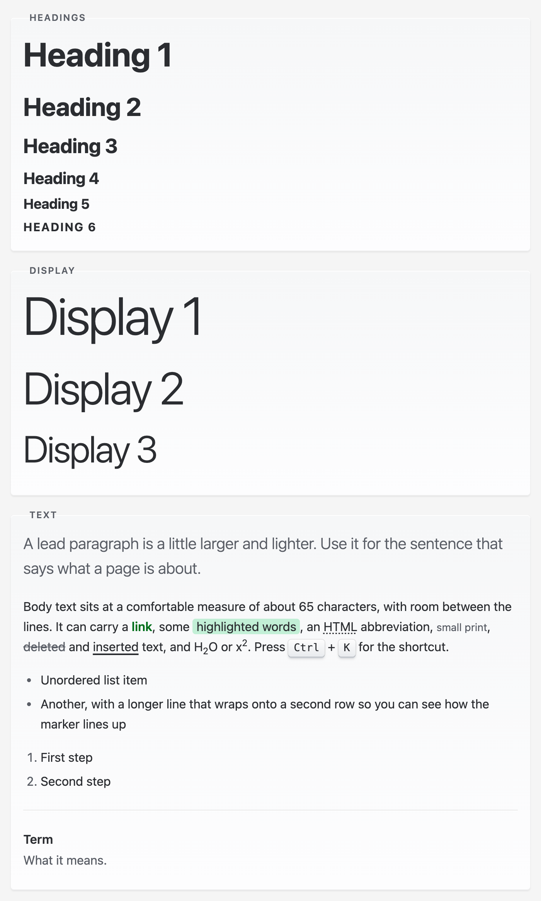

```html
<h1 class="display-1">Display</h1>
<div class="prose">
  <p class="lead">What this page is about.</p>
  <p>Text with a <a href="/">link</a>, <mark>a mark</mark> and <kbd>Ctrl</kbd> + <kbd>K</kbd>.</p>
</div>
```

**Fonts.** The page's own (system) fonts are the default and nothing is downloaded. Set `data-font="sans"`, `"serif"` or `"both"` (serif headings, sans text) on `<html>` to use Inter and Source Serif 4 from Google Fonts; load them yourself with a `<link>` (the demo page does it the first time you pick one). Code always uses a monospace font (JetBrains Mono, then the system's). To use your own fonts, set three tokens:

```css
:root {
  --font-body: "Your Sans", system-ui, sans-serif;
  --font-heading: "Your Serif", Georgia, serif;
  --font-mono: "Your Mono", ui-monospace, monospace;
}
```

### Forms

#### Check list

A fieldset of native checkboxes (the WAI-ARIA *Checkbox (Mixed-State)* pattern). Add `data-checklist` and script puts a **Select all** box on top, checked when every item is and mixed when only some are (it `aria-controls` the items), and a polite status line below ("2 of 4 done"). Disabled items are left out of the count and of select all, and the select-all box has no `name`, so it is never submitted. `data-all` sets its label and `data-done` the word after "x of y". Without JavaScript it is a plain group of checkboxes.

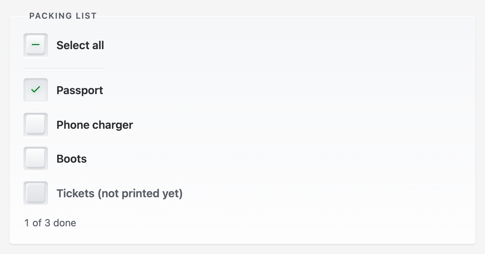

```html
<simar-checklist label="Setlist" all="Check them all" done="rehearsed">
  <simar-checkbox label="Blitzkrieg Bop" name="song" checked></simar-checkbox>
  <simar-checkbox label="Sheena Is a Punk Rocker" name="song"></simar-checkbox>
</simar-checklist>
```

#### Checks and radios

Keys are real buttons, set in a well. They go down quickly and ease back up, a selected key stays latched with its dot lit, and small keys light their label or icon instead. How raised they look depends on the style: `flat` is low, `classic` stands tall on a wall, and `basic` is flat fills and an outline. Checkboxes show a check mark (a dash when mixed) and a switch slides a cap, so neither relies on color alone.

<picture>
  <source media="(prefers-color-scheme: dark)" srcset="docs/screenshots/radios-dark.png">
  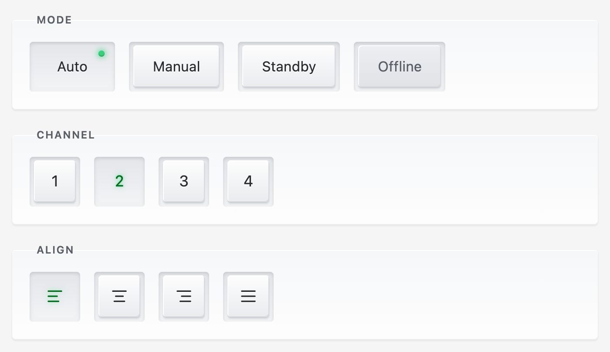
</picture>

<picture>
  <source media="(prefers-color-scheme: dark)" srcset="docs/screenshots/checks-dark.png">
  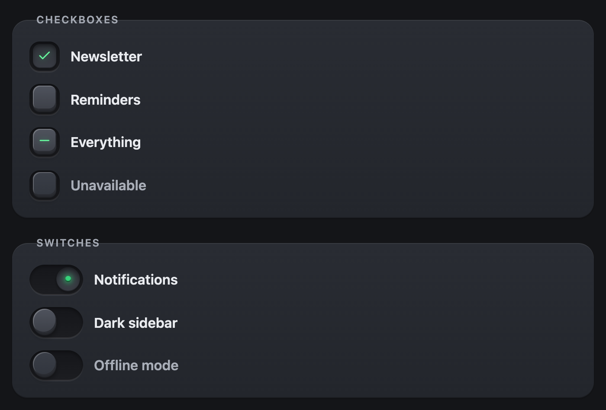
</picture>

```html
<simar-keys name="mode" legend="Mode">
  <simar-key value="auto" checked>Auto</simar-key>
  <simar-key value="manual">Manual</simar-key>
</simar-keys>
<simar-checkbox label="Send me the newsletter" name="news" checked></simar-checkbox>
<simar-switch label="Notifications" name="notify"></simar-switch>
```

#### Datalist and autocomplete

A text field with suggestions: add `list` to an input and point it at a `<datalist>`. It stays a plain input, so anything can still be typed, and the browser shows matches as you type. The list is drawn by the browser, so it follows light and dark but not the rest of the theme. It works on text, search, email, url, number, date, time and color fields.

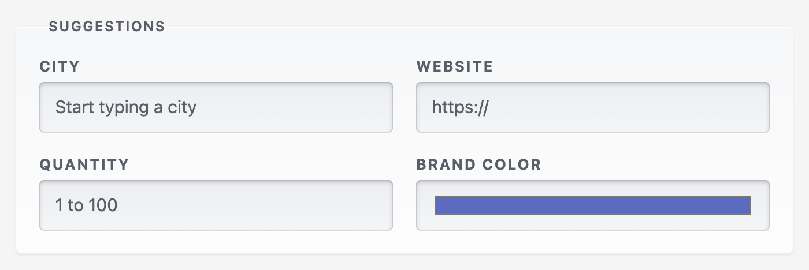

For a themed list that filters as you type, add `data-autocomplete`. The datalist stays as the fallback without JavaScript; with it, a listbox appears under the field with the matching part in bold. It follows the ARIA editable combobox pattern: focus stays in the field, the arrow keys move, Enter picks, Esc closes, and a live region says how many suggestions there are.

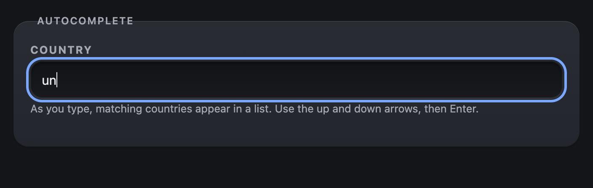

```html
<simar-input label="Country" name="country" suggest>
  <simar-option value="Argentina"></simar-option>
  <simar-option value="Australia"></simar-option>
</simar-input>
```

#### Date range

Two native date inputs stay the source of truth, so typing, `min`/`max` and form submission all work. A calendar opens as a native popover: click a start day, then an end day.

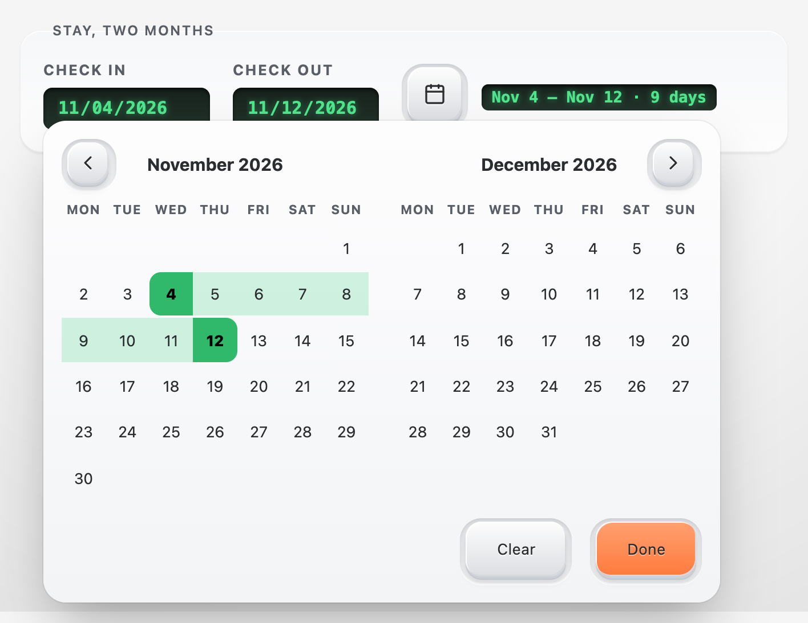

```html
<simar-date-range name="stay" from="2026-11-02" to="2026-11-09" min="2026-10-26" months="2" max-span="14"></simar-date-range>
```

#### Form control

Text-like fields sunk into the panel, like the well a key sits in. One class, `.input`, covers text, email, password, search, tel, url, number, the date and time types, file, textarea and select. Every field has a real `<label>`; a hint and an error are linked to it with `aria-describedby`; a required field is flagged in words.

<picture>
  <source media="(prefers-color-scheme: dark)" srcset="docs/screenshots/form-control-dark.png">
  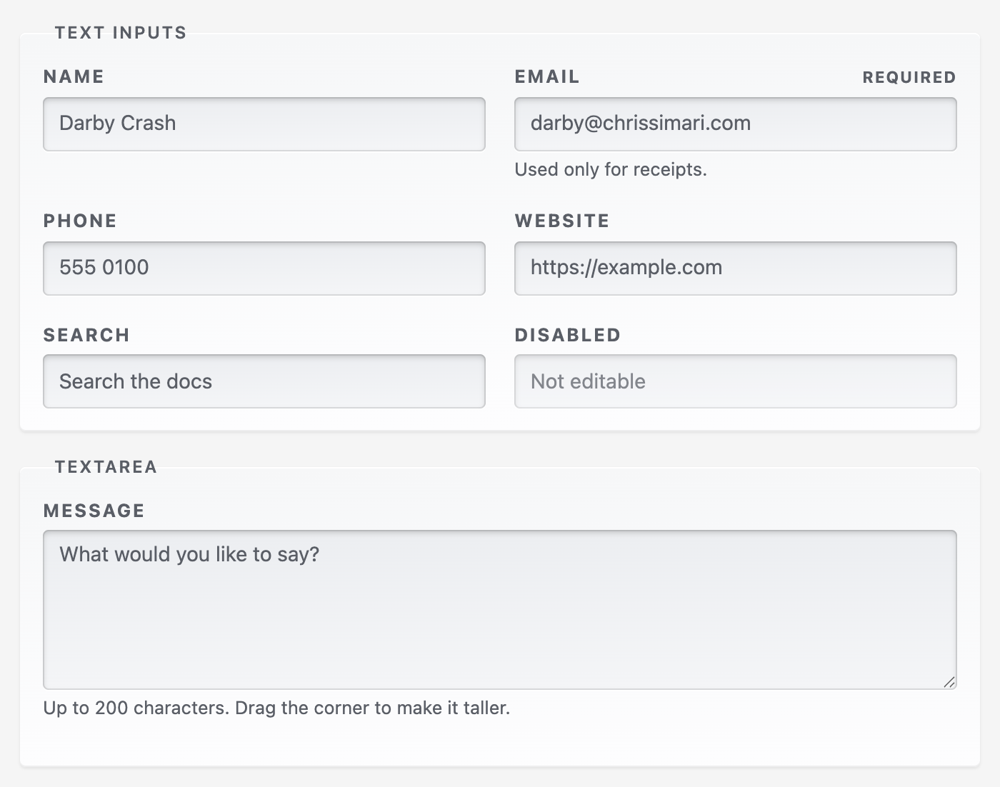
</picture>

```html
<simar-input label="Email" type="email" name="email" required
             hint="Used only for receipts." error="Enter an email like name@chrissimari.com"></simar-input>
<simar-textarea label="Message" name="message" rows="4" maxlength="200"></simar-textarea>
```

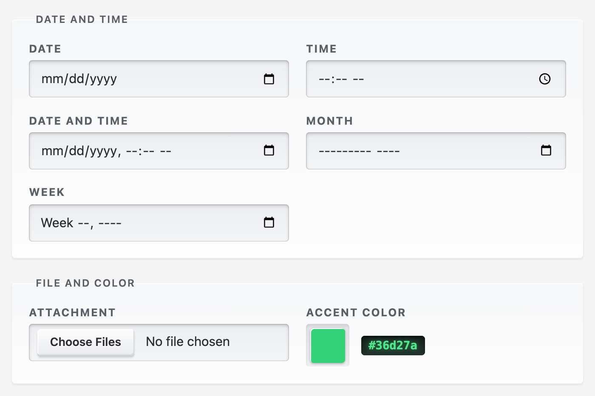

Color has a readout beside it, so the color is never the only way to know what's picked.

#### Input group

A field with a control attached: a number with a key on each side, a password with a show/hide button. Both stay real inputs. The keys are added by the script, announce the new value, and without JavaScript you get the plain native field. The number field follows the ARIA spinbutton pattern in the script too, because browsers differ on whether the arrow keys step a number field: Up and Down step by one, Page Up and Page Down by ten, and min and max are kept.

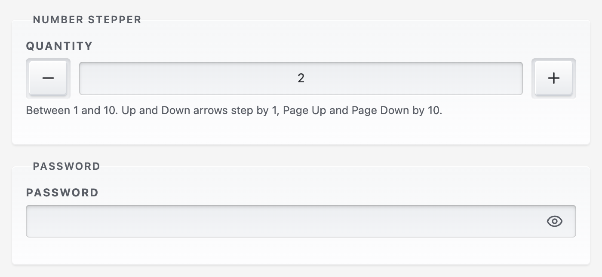

```html
<simar-number label="Quantity" name="qty" min="1" max="10" value="2"></simar-number>
<simar-input label="Password" type="password" name="password" reveal></simar-input>
```

#### Range

Native `<input type="range">` with a gripped cap. `step` snaps the cap, `data-marks` draws a tick at each step, and a pair of inputs makes a min/max range.

<picture>
  <source media="(prefers-color-scheme: dark)" srcset="docs/screenshots/faders-dark.png">
  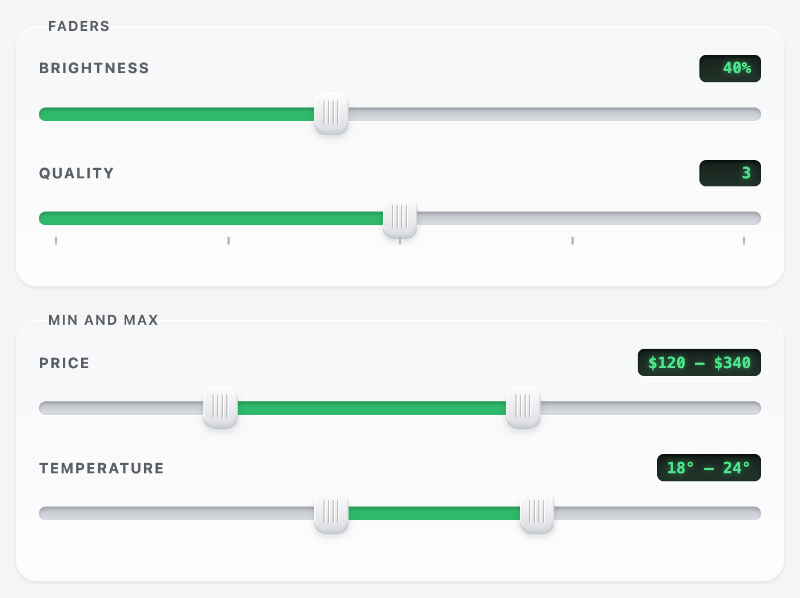
</picture>

Knobs: drag up or right, hold Shift for fine control, double-click to reset, use the arrow keys, or click the ring or a label. `labels` turns a knob into a stepped selector, and a rotary range puts two handles on one arc.

<picture>
  <source media="(prefers-color-scheme: dark)" srcset="docs/screenshots/knobs-dark.png">
  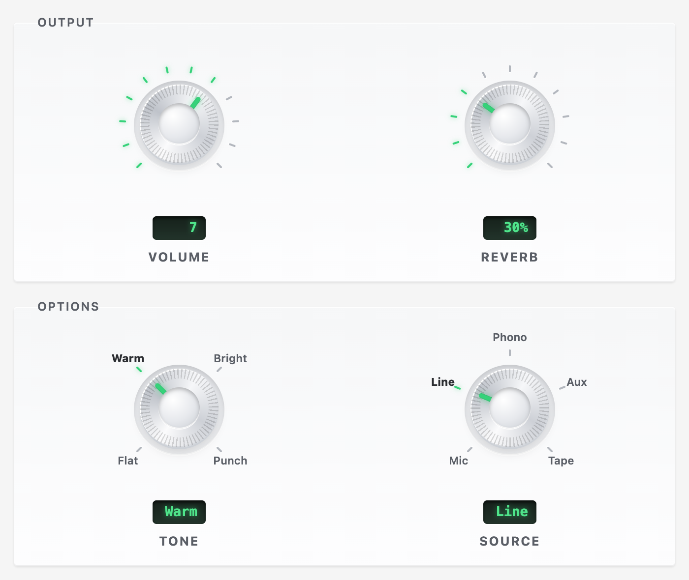
</picture>

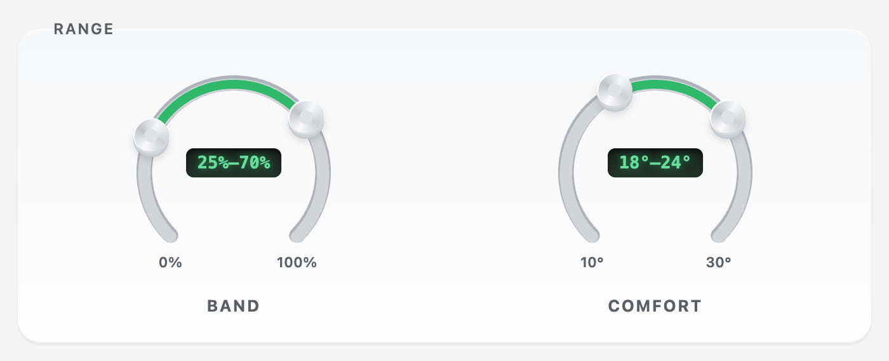

```html
<simar-fader label="Quality" min="1" max="5" step="1" value="3" marks></simar-fader>
<simar-range label="Price" min="0" max="500" step="5" low="120" high="340" prefix="$"></simar-range>
<simar-knob label="Volume" max="11" step="1" value="7" ticks="12"></simar-knob>
```

#### Select

Native `<select>`, so the list that opens is the browser's own: accessible, searchable by typing, and following the theme. Wrap a single select to get the chevron; a multiple select is a list box; `<datalist>` gives a text field native suggestions.

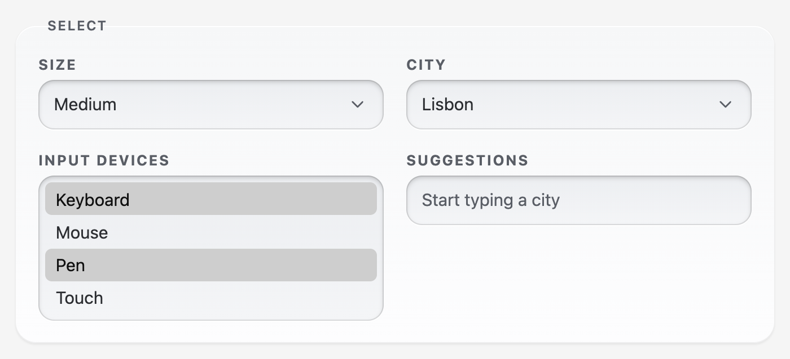

```html
<simar-select label="Size" name="size">
  <simar-option value="s">Small</simar-option>
  <simar-option value="m" selected>Medium</simar-option>
</simar-select>
```

#### Validation

Add `data-validate` to a form and the browser's pop-up bubbles are replaced with messages in the page: words and an icon under each field, linked with `aria-describedby`; a summary announced at the top; focus sent to the first problem; each error clears the moment the field is valid. The text is the field's `data-error`, or the browser's own message. Without JavaScript the browser's native validation still applies.

<picture>
  <source media="(prefers-color-scheme: dark)" srcset="docs/screenshots/validation-errors-dark.png">
  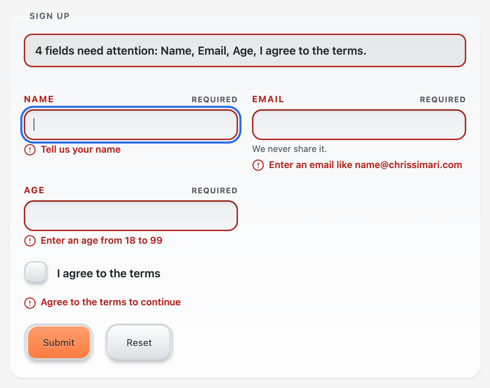
</picture>

```html
<form data-validate>
  <simar-input label="Email" type="email" name="email" required
               error="Enter an email like name@chrissimari.com"></simar-input>
  <simar-checkbox label="I agree to the terms" name="terms" required></simar-checkbox>
  <button type="submit" class="key key--accent">Submit</button>
</form>
```

### Components

#### Accordion, buttons and dialog

A native `<details>` accordion, keys (`<button class="key">`, also on submit and reset), and a native `<dialog>` opened with `command="show-modal"` (no JavaScript needed where supported).

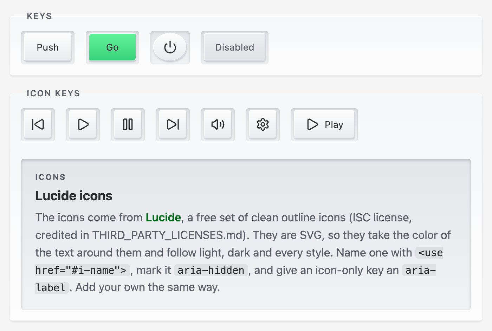

The icons come from [Lucide](https://lucide.dev), a free set of clean outline icons (ISC license, credited in `THIRD_PARTY_LICENSES.md`). They are SVG, so they take the color of the text around them and follow light, dark and every style. Name one with `<use href="#i-name">`, mark it `aria-hidden`, and give an icon-only key an `aria-label`. Add your own the same way.

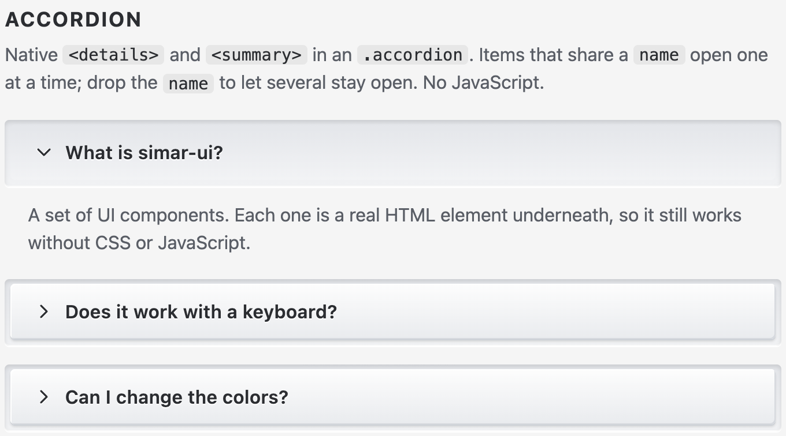

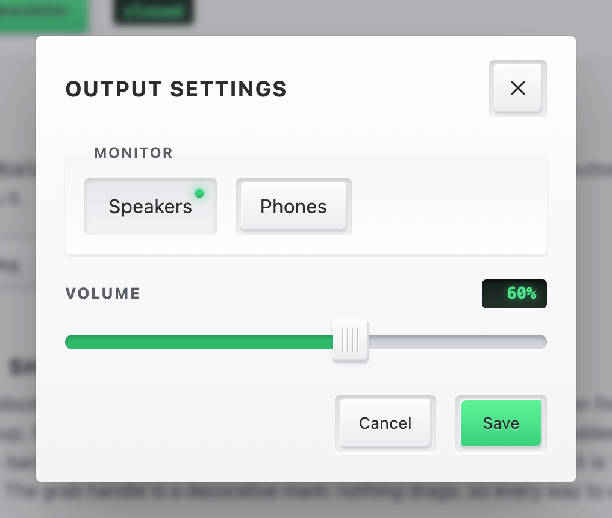

```html
<button type="button" command="show-modal" commandfor="settings">Open</button>

<simar-accordion name="faq">
  <simar-item title="What is it?" open>A set of form controls.</simar-item>
</simar-accordion>
```


#### Alerts and toasts

An alert is a banner in the page with an icon, a title and some words, so the kind of message never depends on color alone: `info`, `success`, `warning` and `danger`. Add `data-dismissible` for a close button. A toast is the same banner shown for a few seconds in a live region, so it is announced without moving focus. It waits while the pointer or focus is on it, can always be dismissed (Esc too), and an error interrupts while the others wait their turn.

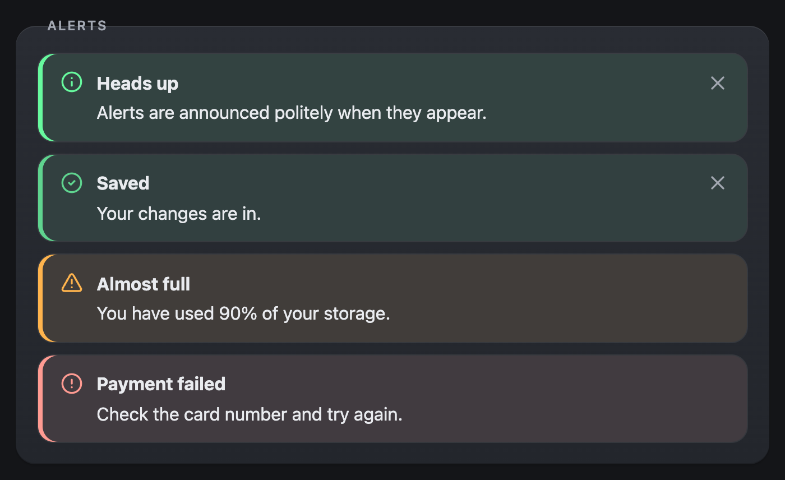

```html
<simar-alert variant="success" title="Saved" dismissible>Your changes are in.</simar-alert>

<button type="button" class="key" data-toast="Your changes are in." data-toast-variant="success">Save</button>
<script>SimarUI.toast("Your changes are in.", { variant: "success", duration: 6000 });</script>
```

#### App bars

A bar that stays at the top or bottom of its scroll area: a native `<header>` or `<footer>` with `position: sticky`, so it needs no script and reads in order without CSS. At the top level of a page they are the banner and content-info landmarks; inside a `<section>` they are plain groups. The bars cover what scrolls beneath them, so the page gets `scroll-padding` and a focused control is never left hidden underneath (WCAG 2.2, Focus Not Obscured). On a narrow screen a bar wraps to a second row rather than pushing the page wider. This page's own header is an app bar. Token: `--appbar-height`.

For a **collapsible mobile menu**, add `data-menu` to the bar and a `<nav class="appbar__nav" aria-label="…">` of links. Script adds a Menu key (a disclosure: `aria-expanded`, `aria-controls`) and the links fold behind it below the md breakpoint (`data-menu="lg"` picks another, `data-menu="always"` folds at every width, `data-menu-label` renames the key). Esc closes it and returns focus to the key, and choosing a link closes it. Without JavaScript there is no key and the links just wrap in the bar. Mark the current page with `aria-current="page"`; it is shown bold and underlined, not by color alone.

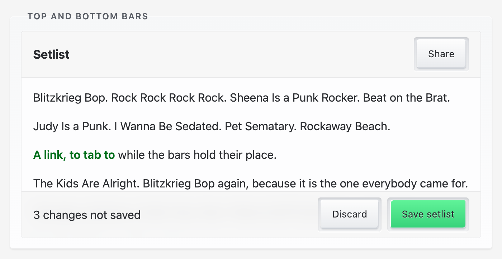

```html
<header class="appbar">
  <a class="appbar__brand" href="/">simar-ui</a>
  <div class="appbar__actions"><span class="well"><button type="button" class="key">Share</button></span></div>
</header>
<footer class="appbar appbar--bottom"> … </footer>
```

A table can keep its heading row and totals in view too: put it in `table-wrap table-wrap--scroll` (height set by `--table-height`) and add `table--sticky`. The cells take a solid color, so rows never show through.

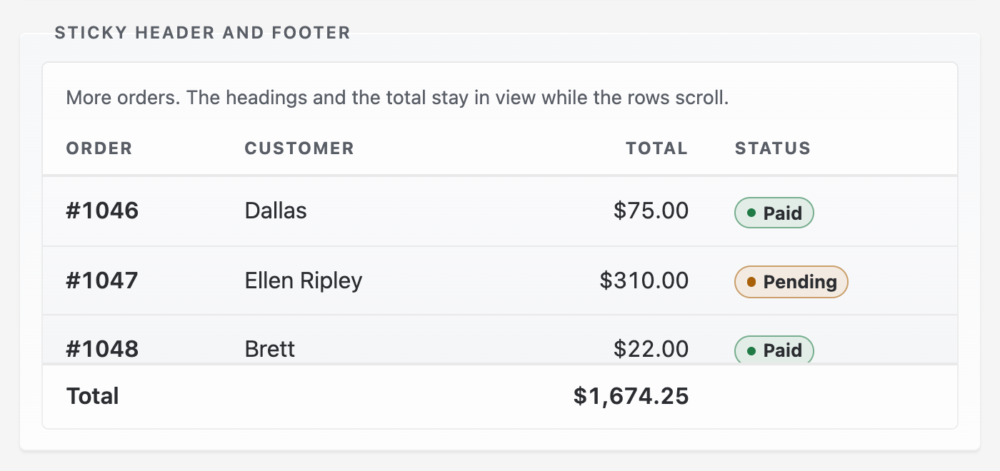

#### Badge

A small label for a status or a count. It always has words (or a number with hidden words after it), so the kind never depends on color alone; the dot is decoration. `badge--info`, `--success`, `--warning`, `--danger` and `badge--count`.

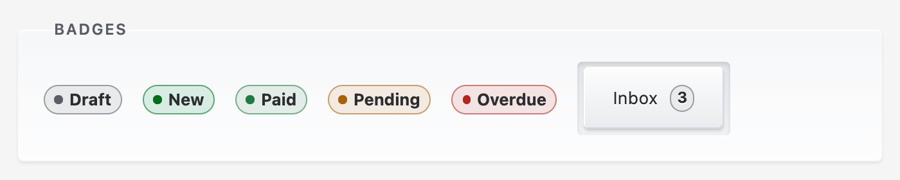

```html
<simar-badge variant="success">Paid</simar-badge>
<button type="button" class="key">Inbox <span class="badge badge--count">3<span class="visually-hidden"> unread</span></span></button>
```

#### Breadcrumb

Where you are in the site: an ordered list of links in a labelled `<nav>`, with the current page as plain text and `aria-current="page"`. The slashes are drawn by CSS with empty alt text, so a screen reader hears a list of links. Long names wrap.

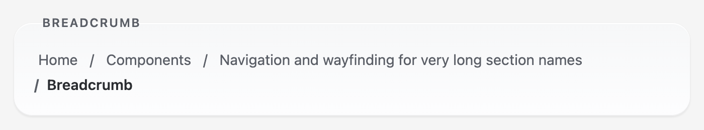

```html
<nav aria-label="Breadcrumb">
  <ol class="breadcrumb">
    <li><a href="/">Home</a></li>
    <li><a href="/components">Components</a></li>
    <li aria-current="page">Breadcrumb</li>
  </ol>
</nav>
```

#### Button group

A few related keys joined edge to edge in one well. Give the group a `role` and an `aria-label` so a screen reader says what it is for. Use it for actions, for toggles (`aria-pressed`, which your script flips) or, with native radios, for choosing one (the arrow keys move between them with no script). Only the two outer ends are rounded and each key keeps its own states, so the selected one stays latched. `key-group--vertical` stacks them, and a group too wide for a narrow screen wraps.

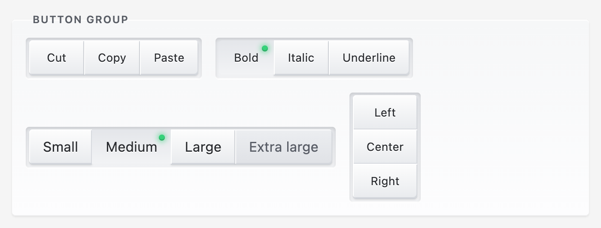

```html
<div class="well key-group" role="group" aria-label="Text style">
  <button type="button" class="key" aria-pressed="true">Bold</button>
  <button type="button" class="key" aria-pressed="false">Italic</button>
</div>
```

#### Charts

A chart is a figure whose data is a native `<table>`. The table is the accessible version, so it works with no script and no chart library. With the optional charts add-on (`dist/simar-ui-charts.min.js`) it is drawn as a **line, bar, pie or donut** chart in SVG by [Chartist](https://chartist.dev) (MIT; load it first, it is not bundled), styled with our theme tokens so it follows light, dark, palettes and styles. The chart is an image named by its title and described by a short summary (`data-summary` to write your own). Each series has its own color, a dash pattern and a legend entry, so color is never the only clue, and the table moves into a "Data table" disclosure that opens from the keyboard. The eight series colors (`--chart-1` to `--chart-8`) are in the theme file and are tested at 3:1 against the panel in light and dark.

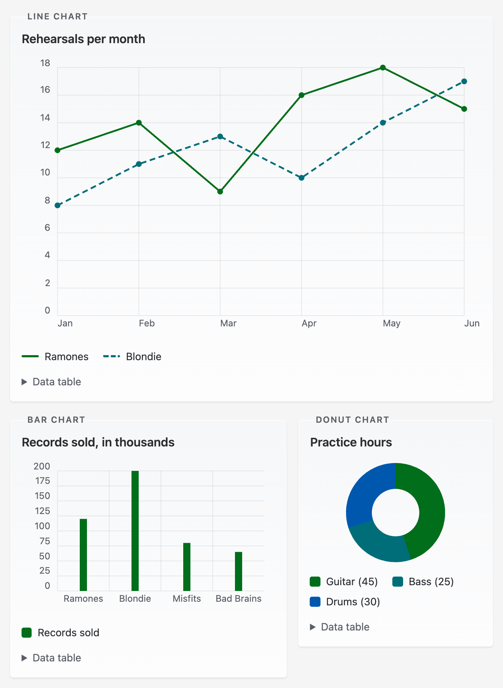

```html
<figure class="chart" data-chart="line">
  <figcaption class="chart__title">Rehearsals per month</figcaption>
  <table class="table">
    <caption class="visually-hidden">Rehearsals per month, by band</caption>
    <thead><tr><th scope="col">Month</th><th scope="col">Ramones</th><th scope="col">Blondie</th></tr></thead>
    <tbody>
      <tr><th scope="row">Jan</th><td>12</td><td>8</td></tr>
      <tr><th scope="row">Feb</th><td>14</td><td>11</td></tr>
    </tbody>
  </table>
</figure>
```

#### Confirmation dialog

A short question and two actions, for something that is hard to undo or that sends something out. It is a `<dialog>` with `role="alertdialog"` (the WAI-ARIA alert dialog pattern), named by its title and described by its message. Focus starts on the safe action (`autofocus` on Cancel), Esc and a click outside both cancel (the result reads "dismissed"), Tab stays in the dialog, and focus returns to the button that opened it. The action says what it does ("Delete draft", not "OK").

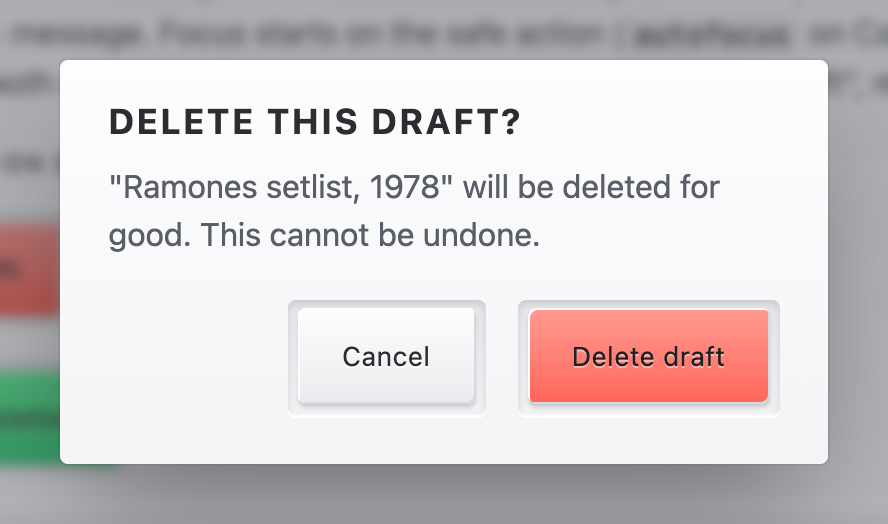

```html
<dialog id="confirm" class="sheet sheet--confirm" role="alertdialog"
        aria-labelledby="confirm-title" aria-describedby="confirm-text">
  <form method="dialog">
    <div class="sheet__body">
      <h3 class="sheet__title" id="confirm-title">Delete this draft?</h3>
      <p class="sheet__text" id="confirm-text">This cannot be undone.</p>
    </div>
    <footer class="sheet__actions">
      <button class="key" value="cancel" autofocus>Cancel</button>
      <button class="key key--danger" value="deleted">Delete draft</button>
    </footer>
  </form>
</dialog>
```

#### Dropdown menu

A button that opens a list of actions or links. It is a native `popover`, so it opens, closes and dismisses with no JavaScript; the script adds the menu roles and the keys from the ARIA menu button pattern (Enter, Space and the arrows open it, arrows, Home, End and letters move, Esc returns focus to the button, Tab leaves).

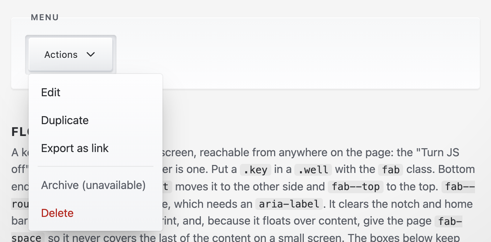

```html
<simar-menu label="Actions">
  <simar-menu-item>Edit</simar-menu-item>
  <simar-menu-item href="/export">Export</simar-menu-item>
  <simar-menu-separator></simar-menu-separator>
  <simar-menu-item danger>Delete</simar-menu-item>
</simar-menu>
```

#### Floating button

A key fixed to a corner of the screen, reachable from anywhere on the page. Put a `.key` in a `.well` with the `fab` class. Bottom end is the default; `fab--start` moves it to the other side and `fab--top` to the top; `fab--round` makes an icon-only one, which needs an `aria-label`. It clears the notch and home bar on a phone, is hidden in print, and its key keeps a target of 24px or more. Because it floats over content, give the page `fab-space` so on a small screen it never covers the last of the content. The "Turn JS off" button on the demo page is one. Token: `--fab-size`.

```html
<span class="well fab"><button type="button" class="key key--accent">Compose</button></span>
```

#### Map

A map whose data is a list of places. The list is the accessible version and works with no script: each place has a link out to OpenStreetMap. With the optional maps add-on (`dist/simar-ui-maps.min.js`) the places are also pins on a map drawn by [Leaflet](https://leafletjs.com) (BSD-2-Clause; load it first, it is not bundled) on OpenStreetMap tiles. The map is a labelled region: the arrow keys move it and plus and minus zoom. The pins are real buttons with names, and the zoom, show-all and pan keys are our own, so dragging is never the only way to move it. Each place in the list gets a "Show on map" button that opens it and puts focus on its pin. The mouse wheel keeps scrolling the page, one finger on a touch screen scrolls the page too, animation is off under reduced motion, and in the dark theme the tiles are darkened. The map shows the OpenStreetMap credit. Tiles come from OpenStreetMap by default, whose [usage policy](https://operations.osmfoundation.org/policies/tiles/) suits light use: point `data-tiles` and `data-attribution` at your own or a commercial provider for more. Tokens: `--map-height`, `--map-radius`, `--map-pin`, `--map-tile-filter`.

```html
<figure class="map" data-map data-zoom="14">
  <figcaption class="map__title">Venues</figcaption>
  <ul class="map__places list list--divided" role="list">
    <li data-lat="40.7254" data-lng="-73.9915">
      <h4 class="map__place-name">CBGB</h4>
      <p class="map__place-text">A club on the Bowery.</p>
      <div class="map__place-actions">
        <a href="https://www.openstreetmap.org/?mlat=40.7254&amp;mlon=-73.9915#map=17/40.7254/-73.9915">Open in OpenStreetMap</a>
      </div>
    </li>
  </ul>
</figure>
```

#### Meter, progress and spinners

`<meter>` for a known quantity (a gauge), `<progress>` for work being done, and a spinner. The meter's fill is told apart by pattern as well as color: solid is good, striped is middling, dotted is poor. Motion stops with `prefers-reduced-motion`, and `data-paused` freezes it.

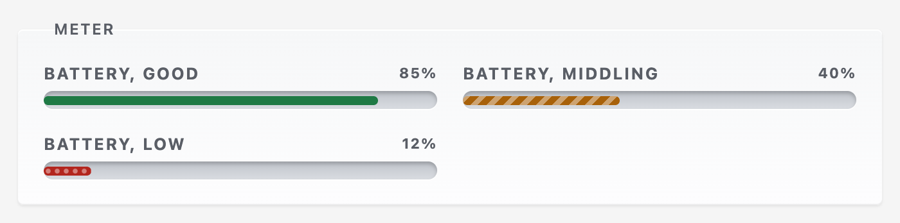

<picture>
  <source media="(prefers-color-scheme: dark)" srcset="docs/screenshots/progress-dark.png">
  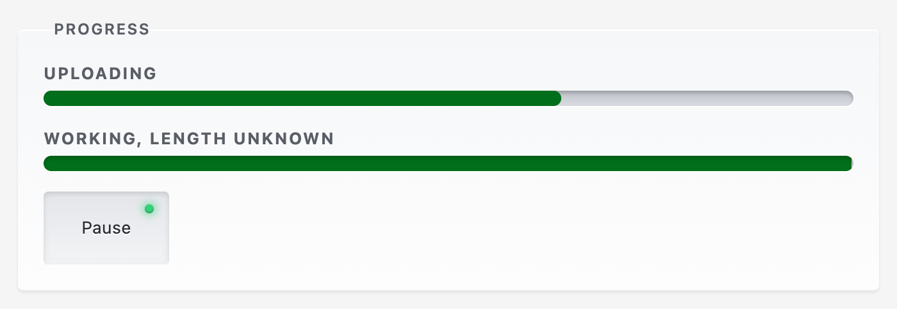
</picture>

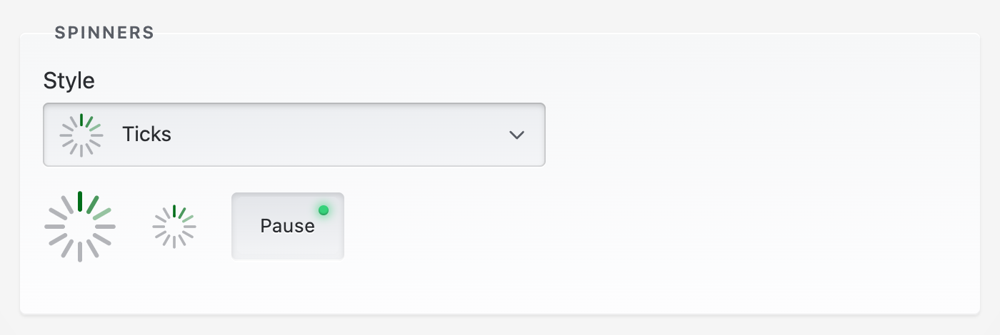

Four spinner styles, all SVG so they stay crisp on any background: `ticks` (default), `ring`, `dots` and `bars`. Pick one with `variant` on the tag or a `spinner--ring` class.

```html
<simar-meter label="Battery" value="85" low="20" high="50" optimum="100"></simar-meter>
<simar-loader label="Uploading" value="64" max="100"></simar-loader>
<simar-spinner label="Loading results" variant="ring"></simar-spinner>
```

#### Pagination

Page links in a `<nav>` with its own label. They are real links, so they work without JavaScript. The current page has `aria-current="page"` and stays latched; Previous and Next carry `rel="prev"` and `rel="next"`, and one that can't be used is `aria-disabled="true"`.

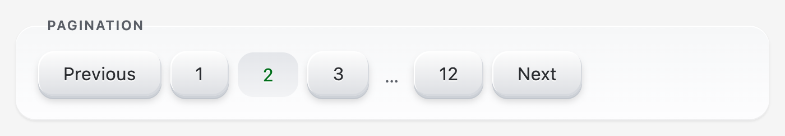

```html
<nav class="pagination" aria-label="Orders pages">
  <ul class="pagination__list">
    <li><a class="key" href="?page=1" rel="prev">Previous</a></li>
    <li><a class="key" href="?page=2" aria-label="Page 2, current page" aria-current="page">2</a></li>
    <li><a class="key" href="?page=3" rel="next">Next</a></li>
  </ul>
</nav>
```

#### Side menu

A tab on the edge of the screen that opens a panel beside it, for options or navigation that should be one press away without taking room. It is a disclosure, not a modal: the tab is a button with `aria-expanded` and `aria-controls`, Esc closes the panel and returns focus to the tab, and so does moving focus out of it. Without JavaScript the panel is just content in the page. `side-menu--start` puts it on the left edge, `side-menu--docked` keeps the panel open as a column from the xl breakpoint (75rem) up, and `data-close-on-select` closes it when a link inside is chosen. Open or close one from code with the `side-menu:open` and `side-menu:close` events. The demo page's contents list and settings are both side menus. Tokens: `--side-menu-radius`, `--side-menu-width`.

```html
<aside class="side-menu side-menu--end" data-side-menu aria-label="Options">
  <button type="button" class="key key--sq side-menu__toggle"
          aria-label="Options" aria-expanded="false" aria-controls="options">…</button>
  <div class="panel side-menu__panel" id="options">…</div>
</aside>
```

#### Table

A native `<table>` with a `<caption>` and `<th scope>`, in a `.table-wrap` that scrolls sideways on a narrow screen (the wrapper takes keyboard focus). `table--striped`, `table--hover`, and `data-sortable` with `data-sort` on headers for sorting: the script adds the buttons and keeps `aria-sort` on one column.

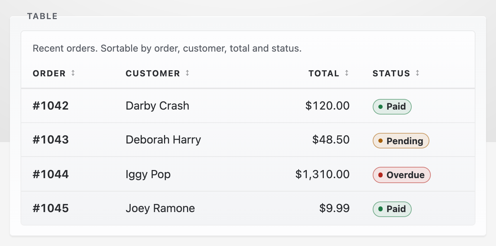

```html
<div class="table-wrap" role="region" aria-labelledby="cap" tabindex="0">
  <table class="table table--hover" data-sortable>
    <caption id="cap">Recent orders</caption>
    <thead><tr><th scope="col" data-sort>Order</th><th scope="col" class="num" data-sort>Total</th></tr></thead>
    <tbody><tr><th scope="row">#1042</th><td class="num">$120.00</td></tr></tbody>
  </table>
</div>
```

#### Tabs

Write each tab as a headed section. Without JavaScript they stack under their headings; with it the headings become traditional tabs, close together and rounded on top, with the selected one joined to its panel, and one panel shows at a time. Left and Right arrows, Home and End move between tabs (the ARIA tabs pattern).

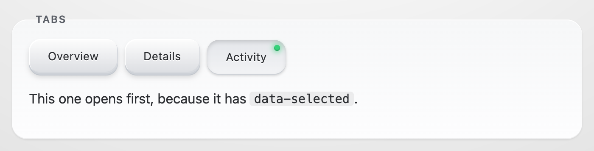

```html
<simar-tabs label="Project">
  <simar-tab title="Overview">The summary.</simar-tab>
  <simar-tab title="Details" selected>The details.</simar-tab>
</simar-tabs>
```

#### Tooltips

Add `data-tooltip="Text"` to a button, link or radio key. It shows on mouse hover and on keyboard focus, Esc dismisses it, and you can move the pointer onto it (WCAG 1.4.13). Icon-only keys with an `aria-label` get theirs as a tooltip automatically; opt one out with `data-tooltip=""`.

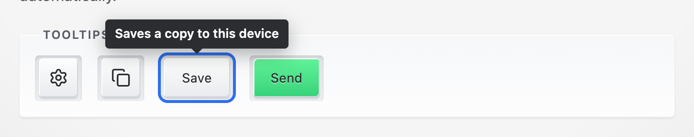

```html
<button type="button" class="key" aria-label="Settings" data-tooltip="Settings">…</button>
<simar-button tooltip="Saves a copy to this device">Save</simar-button>
```

Keep the `aria-label` in the markup: a tooltip needs JavaScript, a label doesn't. The library warns if a control's only name is its tooltip.

## Themes

All of the styling is a theme: the components describe structure and read their colors, fonts and shapes from tokens, so a new look is a change to values and never to the components. Color lives in one file in `scss/themes/` (`_default.scss`): the design tokens for light and dark, the highlight presets (`data-lit`, including the Material palette), the color of each button variant (`key--primary`, `--secondary`, `--success`, `--danger`, `--warning`, `--info`, `--light`, `--dark`) and whole-page palettes (`data-palette="indigo"`, `teal`, `rose`, `amber`, `forest`, `ocean`), which retint every surface and bring their own highlight and button colors. Shape and depth live in `scss/themes/_styles.scss` (see [Styles and design tokens](#styles-and-design-tokens)), so a style, a palette and a highlight combine freely.

## Styles and design tokens

Shape and depth are CSS custom properties, so a developer can change one thing without touching the rest. Set them on `:root` for the whole page, or on any element for just that part:

```css
:root { --radius: 8px; --radius-lg: 12px; --depth: 0.5; }   /* everything at once */
.card { --card-radius: 0; }                                  /* one component */
.sidebar { --radius: 20px; --ring-w: 2px; }                  /* one part of the page */
```

- **Global tokens:** `--radius` (controls), `--radius-lg` (surfaces), `--depth` (every soft shadow, 0 is none), `--fade` (every gradient, 0% is a flat color), `--travel` (how tall a key stands), `--bevel`, `--cap-drop`, `--cap-blur`, `--ring-w` and `--ring-mix` (an outline round everything), `--wall-ink`, `--wall-far-mix` and `--elev-*` (the shadow under panels).
- **Component tokens:** each component has its own radius (`--key-radius`, `--input-radius`, `--panel-radius`, `--card-radius`, `--sheet-radius`, `--menu-radius` and more, all listed on the demo page). If you don't set one, it falls back to the global radius.
- **Styles:** `data-style="basic | brutal | classic | crisp | deep | flat | line | round | soft"` on `<html>` or any element sets a whole bundle of these tokens. With no `data-style` you get `flat`. Colors stay with `data-theme`, `data-palette` and `data-lit`, so every style works in light and dark and with every palette. `basic` is plain, functional HTML: flat fills, a thin outline and a 2px radius. A new style is one more entry in `scss/themes/_styles.scss`.
- **Theme builder:** the demo page has sliders that change the main tokens on a preview and give you the CSS to copy. The Style select in Page settings switches the whole page.

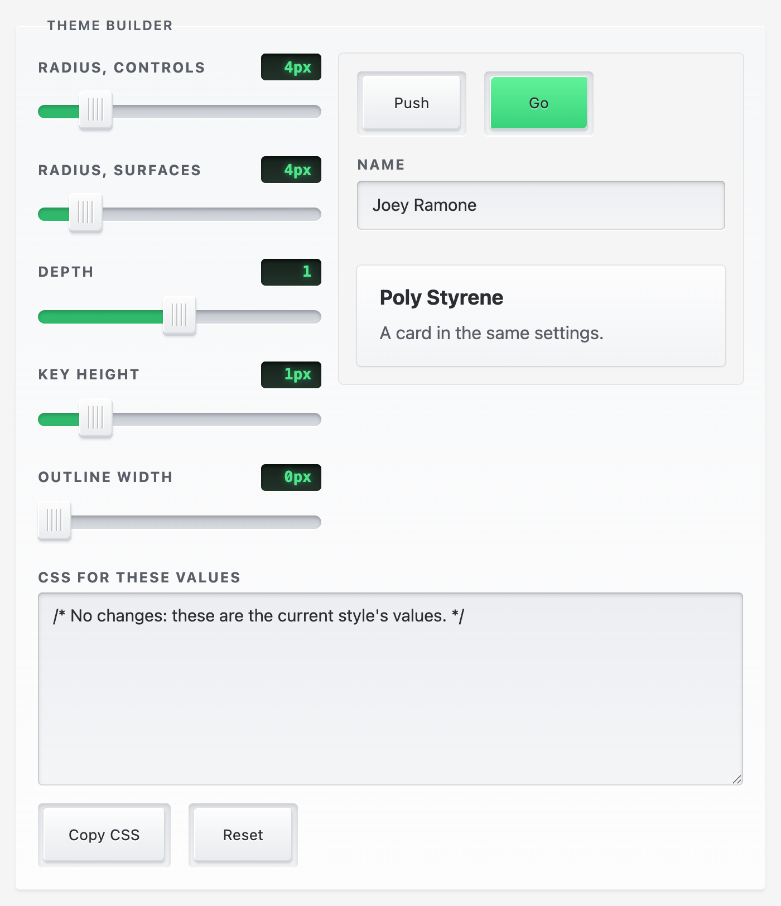

## Light and dark

simar-ui follows the system setting. To choose, put `data-theme="dark"` or `data-theme="light"` on `<html>`, or on any element to theme just that part of the page. The demo has an **Appearance** dropdown (Auto, Light, Dark) in the top right; Auto is the default.

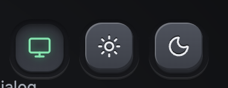

The demo page's contents list floats in the left margin on wide screens, marking the section you're reading. Below 76rem it folds into an icon that floats on the left edge and opens a drawer (Esc closes it, and so does choosing a link). Without JavaScript it simply sits above the page. A matching settings icon on the right edge opens Theme, Highlight and Font once you've scrolled past the Page settings panel:

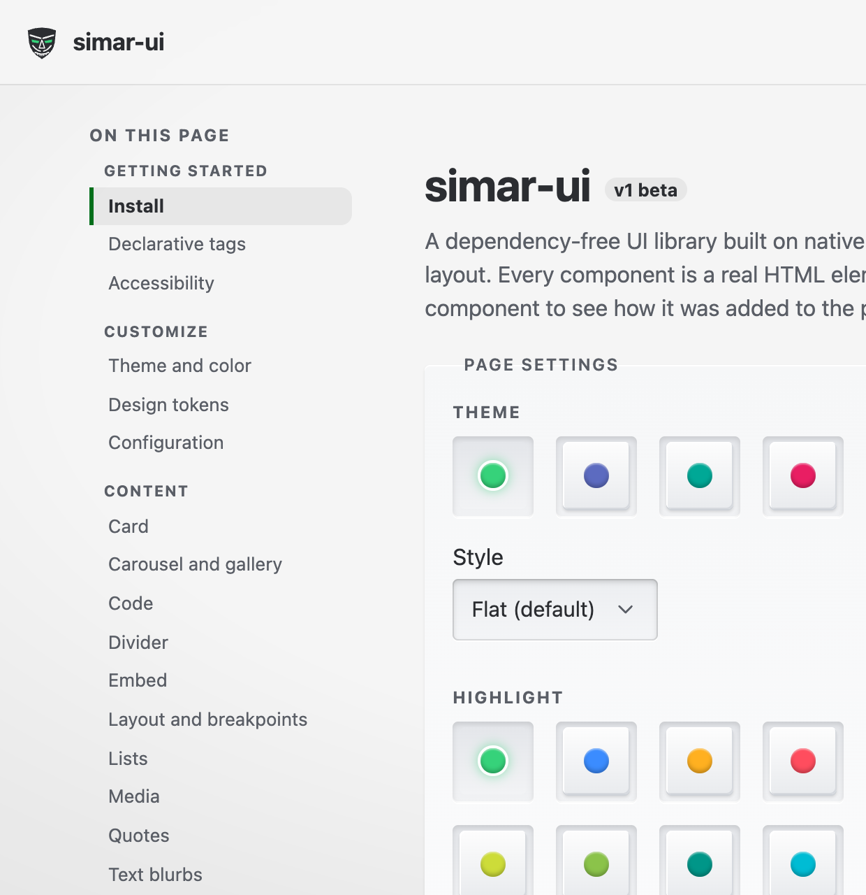

### Highlight color

One value, `--lit`, recolors every lit part. Set it on any element, or pick a preset with `data-lit`.

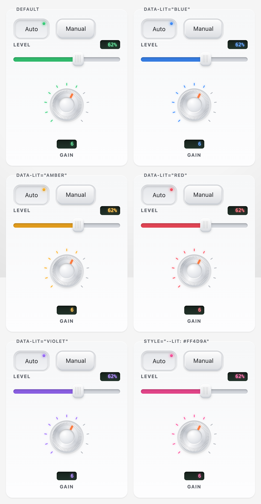

```html
<section data-lit="blue">…</section>
<div style="--lit: #ff4d6d">…</div>
```

Every color and size is a CSS custom property, so you can restyle without touching the source:

```css
:root {
  --lit: #ff4d6d;     /* highlight */
  --accent: #3b8cff;  /* the accent key */
  --radius: 10px;     /* key corners */
  --travel: 3px;      /* how tall keys stand */
}
```

## Configure with HTML

| Attribute | On | Effect |
| --- | --- | --- |
| `min` `max` `step` `value` `name` | range, date | Native meaning. `step` snaps the cap to each value |
| `data-marks` / `marks` | fader | Tick marks at every step, or `data-marks="5"` for five |
| `data-ticks`, `data-labels` | knob | Tick count, or labelled detents (click a label to jump to it) |
| `data-unit`, `data-prefix` | faders, knobs, ranges | Text around the readout |
| `data-lit="blue"`, `style="--lit:#ff4d6d"` | any element | Highlight color for it and everything inside |
| `data-theme="dark"` / `"light"` | any element | Force a theme; leave off to follow the system |
| `data-style="basic"`, `"brutal"`, `"classic"`, `"crisp"`, `"deep"`, `"flat"`, `"line"`, `"round"`, `"soft"` | any element | Shape and depth of every component; leave off for `flat` |
| `data-haptic="off"` | any element | Vibration: `on`, `off`, `tick`, `click`, `heavy`, or milliseconds like `10,30,10` |
| `data-months`, `data-max-span`, `data-first-day` | date range | Months shown, longest range in days, week start |
| `name="faq"` / `multiple` | accordion | Items open one at a time, or several at once |
| `data-paused` | spinner, loader (or an ancestor) | Freezes the loading motion |
| `data-tooltip="Text"` | button, link, radio key | A tooltip on hover and keyboard focus (Esc dismisses). On a tag: `tooltip="Text"` |
| `checked` `disabled` `indeterminate` | checkbox, switch | Native states; `data-indeterminate` sets the mixed state |
| `data-validate` | form | Show validation as messages in the page (see Validation) |
| `required`, `hint`, `error`, `reveal` | form-control tags | Required flag, hint text, error text, show/hide on a password |
| `nolines` / `nocopy` | code block | Leave off the line numbers or the copy button |
| `data-lit`, `data-palette="indigo"`, `data-font="serif"` | `<html>` or any element | Highlight color, whole-page theme (indigo, teal, rose, amber, forest, ocean) and fonts (sans, serif, both; system fonts by default) |
| `variant="ring"` / `spinner--ring` | spinner | ticks (default), ring, dots or bars |
| `data-tabs` | tabs wrapper | Turns headed sections into tabs |
| `data-sortable`, `data-sort` | table, header cells | Sortable columns with `aria-sort` |
| `data-autocomplete`, `list="id"` | text input | A themed suggestion list over a `<datalist>`; `data-autocomplete="first"` makes Enter take the top result |
| `data-dismissible` | alert | Adds a close button |
| `data-toast`, `data-toast-variant`, `data-duration` | button | Shows a toast when pressed; `SimarUI.toast(text, options)` does the same from script |
| `popovertarget`, `.menu__list` | dropdown menu | A native popover; the script adds the menu roles and keys |
| `select[data-picker]` | select | A list that can show moving artwork (see the spinner picker) |

Haptics use the browser's Vibration API, so there is nothing to install. It works on Android browsers; iOS Safari doesn't support it and the calls are skipped. They are wired once for the whole page rather than per component: every button, summary and link drawn as a key clicks, radios, checkboxes and switches click when they change, selects tick, and range inputs (faders and knobs) tick as they move. `data-haptic` on any element changes or turns off everything inside it.

## Accessibility

Every control is a native element, so the keyboard, focus and screen-reader behavior comes from the browser, and the styling sits on top.

- **Keyboard:** everything is reachable and operable. Knobs and faders respond to the arrow keys, Home and End; the calendar has full arrow, Page Up/Down, Home and End navigation; Esc closes dialogs and the calendar.
- **Names:** a knob or fader is its `<input>` with a real `<label>`; icon-only keys need an `aria-label` (the tags take a `label` attribute).
- **Focus:** every stop shows a ring, in both themes, and is never hidden behind the floating buttons.
- **Color:** text meets WCAG AA (4.5:1) in light and dark and in every highlight preset, including on the gradient key caps and the dark readout screens. The preloader's fill and lit tick meet 3:1 against what's behind them.
- **No dragging required (WCAG 2.5.7):** a click on a knob's ring, the groove of a two-handle range, or the arc of a rotary range sets the value; stepped knobs also jump when you click a label.
- **Reflow and target size:** no sideways scrolling down to 320px wide; every target is at least 24 by 24px.
- **Motion and contrast modes:** `prefers-reduced-motion` turns transitions and animation off (the preloader shows a still "busy" state). In `forced-colors` (Windows High Contrast) the controls drop their gradients and use only system colors, so the user's own theme decides.
- **Tooltips (WCAG 1.4.13):** dismissible with Esc, hoverable, persistent, shown on keyboard focus, linked with `aria-describedby`, and kept on screen at the page edge.
- **Code blocks:** line numbers are skipped by screen readers, can't be selected, and aren't copied; the block can be scrolled by keyboard.
- **ARIA patterns:** native elements first. Where none exists the component follows the WAI-ARIA Authoring Practices exactly: tabs (arrows, Home, End), menu button (arrows, letters, Esc, Tab), editable combobox for autocomplete (`aria-activedescendant`, a live count of suggestions) and select-only combobox for the picker. Alerts use `role="status"`, and errors `role="alert"`.
- **Disabled controls** are held to 4.5:1 too, even though WCAG exempts them, so they stay readable in every theme.
- **Toasts (WCAG 2.2.1):** announced in a polite live region, paused while hovered or focused, dismissible by button or Esc.
- **Standard:** the target is WCAG 2.2 AA, 100%, which covers what the ADA, Section 508 and the DOJ's WCAG 2.1 AA rule point to. We say "tested against WCAG 2.2 AA", not "ADA compliant": that is a legal judgment this project can't make.

### Safeguards

- **While you build:** after the page is enhanced, `src/audit.js` checks for controls with no accessible name, unnamed dialogs, and scrolling code blocks that keyboard users can't reach. Each problem is logged (`[simar-ui] accessibility: ...`), marked with `data-a11y-issue`, and outlined in dashed red on localhost, `file:` pages, or with `?a11y` in the URL. Call `SimarUI.audit()` to run it again.
- **Before you ship:** `npm run test:a11y` runs, in both light and dark:
  - the [axe](https://github.com/dequelabs/axe-core) engine, with every rule on, over the demo in each state (JS on and off, calendar open, dialog open);
  - a contrast check across every gradient and highlight preset (axe can't do gradients);
  - WCAG 2.2 checks for 320px reflow, target size, reduced motion, forced colors, click-only alternatives to dragging, non-text contrast and the accessibility tree;
  - a keyboard pass that tabs through every control and checks the focus ring is actually on screen and not hidden behind a floating button;
  - the same checks with every highlight color, every whole-page palette, the font choices, and states such as menus, suggestions and toasts showing;
  - behavior tests for tabs, the menu, autocomplete, sortable tables, the contents drawer, the settings tab, header search, pagination, breadcrumbs, media, cards and button groups, and a responsive grid test at phone, tablet and desktop widths;
  - an app test that serves the page, checks the manifest and icons and the service worker, and loads the page with the network off.

  `npm test` builds first; `npm publish` runs it automatically.
- **The tests can fail.** `SABOTAGE=1 node tests/keyboard.mjs` strips the focus rings and the run must exit non-zero.
- **If a check fails, fix the page. Do not switch the rule off.**

What automation can't cover, and you should test by hand: what real screen readers (VoiceOver, NVDA, TalkBack) actually announce (Chrome's automation interface can't show `aria-valuetext`, so the stepped knobs' labels in particular need a listen), touch and switch access, and Safari and Firefox.

## Offline and installable

The demo and docs page is a small web app: a [manifest](manifest.webmanifest) with the app icons (192, 512 and a maskable one, made from the logo with `npm run icons`) and a service worker (`sw.js`). Served over https (or localhost) it works offline, and a browser can install it. When a new version has been fetched in the background, the page says so and offers a reload. The library in `dist/` does not need any of this. When you change the version in `package.json`, change `VERSION` in `sw.js` too; a test checks they match.

## Without JavaScript

Keys, radio keys, the accordion, the progress bar, and the dialog (via `command="show-modal"`) are CSS and HTML only. Faders, knobs and date fields fall back to their native inputs, styled as plain faders. `html[data-js="on"]` is set when the script runs, so your own CSS can tell the two cases apart. The demo's **Turn JS off** button shows exactly how it downgrades.

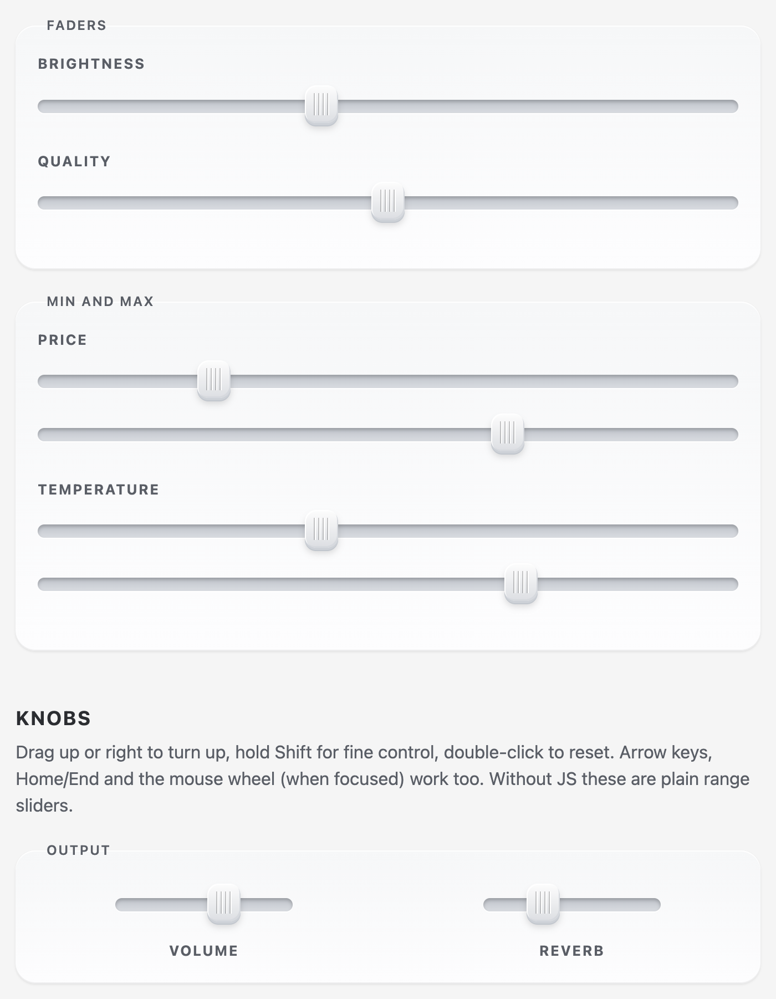

In Windows High Contrast the controls use system colors:

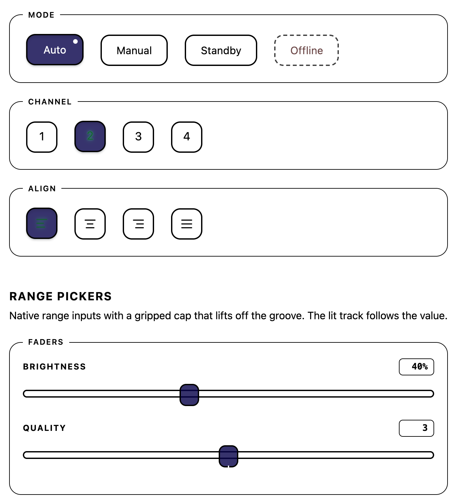

## Browser support

Recent evergreen browsers. simar-ui uses modern CSS (`color-mix()`, `:has()`, `@property`, the Popover API) and degrades where it can: no animated key fades without `@property`, no `command` invokers in older browsers (a small fallback opens dialogs). It has been tested in Chrome; Firefox and Safari are not yet tested.

## Build

The library is SCSS (`scss/`) and one JavaScript entry (`src/`). Compiled files are committed in `dist/` so the demo and CDN work without a build.

```sh
npm install
npm run build          # css, js, demo css
npm run dev            # watch the SCSS
npm run serve          # http://localhost:8000
npm test               # build, then every accessibility check
npm run screenshots    # regenerate docs/screenshots
```

```
scss/       simar-ui.scss (library), docs.scss (demo page only)
src/        simar-ui.js, tags.js, audit.js, icons.svg
dist/       built css, js, icon sprite
docs/       demo-only scripts and styles, themes.html, screenshots
tests/      accessibility tests
index.html  the demo and documentation page
```

## Roadmap

Next: check list, sticky bars (top and bottom, and table headers and footers), carousel and photo gallery, an icon dropdown, a Material set (bottom navigation, top app bar, bottom sheet, chips, search bar, time picker), suggested flows, more chart types, avatar, skeleton loader, empty state, popover variants, rating, tree view, file dropzone. Also planned: a review of edge cases (right-to-left text, print, very long words, high zoom), a naming audit so every class and token follows one vocabulary, spacing and sizing utilities, fallbacks for older browsers, and a periodic check that each component still matches its spec.

## Contributing

Contributions are welcome, and every change to the library has to come with tests at the same standard as the rest of the project (a check enforces it on pull requests). See [CONTRIBUTING.md](CONTRIBUTING.md).

## How it's made

simar-ui is designed and directed by Chris Simari and built with AI assistance (Claude, by Anthropic). Chris chose the look, the scope and the rules, and reviewed the work as it went. The accessibility, keyboard, contrast and layout claims in this README are backed by the tests in `tests/`, which run on every build, so they don't depend on who or what wrote the code. If you find something wrong, please [open an issue](https://github.com/roboteight/simar-ui/issues).

## License

Copyright &copy; 2026 [Chris Simari](https://chrissimari.com/projects/simar-ui). [MIT](LICENSE), free for any use. Icons are from [Lucide](https://lucide.dev) (ISC), see [`THIRD_PARTY_LICENSES.md`](THIRD_PARTY_LICENSES.md).
