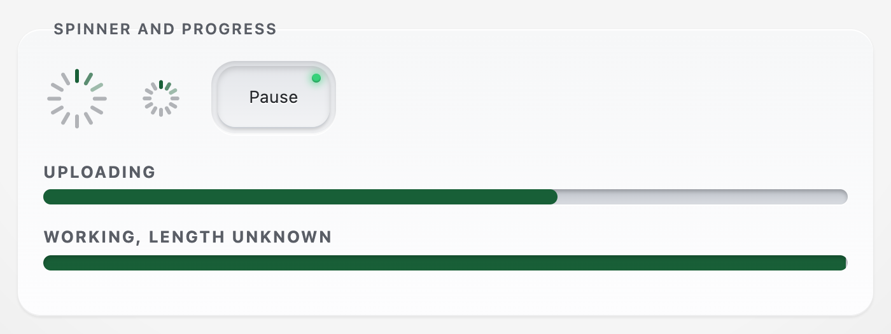

# simar-ui v1


**Beveled, extruded form controls built on real HTML elements.** Keys, faders, knobs, a date range, a dialog, an accordion, a code block and a preloader, in light and dark. You configure them with HTML attributes, they work without JavaScript, and they're built to be fully accessible.

<picture>
  <source media="(prefers-color-scheme: dark)" srcset="docs/screenshots/hero-dark.png">
  
</picture>

**Free and open source.** simar-ui is public and MIT licensed: use it in personal and commercial projects, change it, and ship it, no strings attached.

- **Native underneath.** Every control is an `<input>`, `<button>`, `<progress>`, `<details>` or `<dialog>`, so forms, labels, validation, keyboard and screen-reader behavior come from the browser. The styling sits on top.
- **Configured in HTML.** Options are attributes (`min`, `max`, `step`, `data-lit="blue"`, `data-haptic="off"`), or short tags like `<simar-knob label="Volume" max="11">`. No config objects.
- **Accessible, and kept that way.** Keyboard operable, WCAG 2.2 AA contrast, no dragging required, reduced motion and high contrast supported. Automated tests run in light and dark, and the library warns you while you build if you forget a label. [More below.](#accessibility)
- **No dependencies, no build step to use it.** Two files from a CDN, or `npm install`.

## Install

**From a CDN** (two lines):

```html
<link rel="stylesheet" href="https://cdn.jsdelivr.net/gh/roboteight/simar-ui@1/dist/simar-ui.min.css">
<script src="https://cdn.jsdelivr.net/gh/roboteight/simar-ui@1/dist/simar-ui.min.js" defer></script>
```

**With npm:**

```sh
npm install simar-ui
```

```js
import 'simar-ui/css';
import 'simar-ui'; // starts itself
```

**Or copy the files:** `dist/simar-ui.min.css` and `dist/simar-ui.min.js`.

The script injects its own icons. To have icons also show with JavaScript off, paste `dist/simar-ui-icons.svg` into the page once, just inside `<body>`.

## Use it

Write the native markup, or use short tags that expand into it:

```html
<simar-fader label="Brightness" name="brightness" min="0" max="100" value="40" unit="%"></simar-fader>
<simar-knob label="Tone" name="tone" max="3" step="1" labels="Flat,Warm,Bright,Punch"></simar-knob>
<simar-date-range name="stay" from="2026-11-02" to="2026-11-09" months="2"></simar-date-range>
```

The tags are replaced with real inputs, so values submit with their form and `input` / `change` events work as usual. Tags need JavaScript; the native markup doesn't. For markup added after page load, call `SimarUI.init(element)`.

Open `index.html` for the live demo, with a contents list that floats on the left: every component has an **HTML** key that shows exactly how it was added to the page, with the tag form and JavaScript examples.

## What's inside

### Keys and radio keys

Beveled caps that sit in a recessed well. They go down quickly and ease back up, a selected key stays latched with its dot lit, and small keys light their label or icon instead.

<picture>
  <source media="(prefers-color-scheme: dark)" srcset="docs/screenshots/radios-dark.png">
  
</picture>

```html
<simar-keys name="mode" legend="Mode">
  <simar-key value="auto" checked>Auto</simar-key>
  <simar-key value="manual">Manual</simar-key>
</simar-keys>
```


### Checkboxes and switches

Native `<input type="checkbox">` in the same recessed well. Checking latches the key down and lights its check mark (a dash when mixed); a switch is a checkbox with `role="switch"` and a cap that slides. Neither relies on color alone.

<picture>
  <source media="(prefers-color-scheme: dark)" srcset="docs/screenshots/checks-dark.png">
  
</picture>

```html
<simar-checkbox label="Send me the newsletter" name="news" checked></simar-checkbox>
<simar-switch label="Notifications" name="notify"></simar-switch>
```

### Faders and ranges

Native `<input type="range">` with a gripped cap. `step` snaps the cap, `data-marks` draws a tick at each step, and a pair of inputs makes a min/max range.

<picture>
  <source media="(prefers-color-scheme: dark)" srcset="docs/screenshots/faders-dark.png">
  
</picture>

```html
<simar-fader label="Quality" min="1" max="5" step="1" value="3" marks></simar-fader>
<simar-range label="Price" min="0" max="500" step="5" low="120" high="340" prefix="$"></simar-range>
```

### Knobs

Drag up or right, hold Shift for fine control, double-click to reset, use the arrow keys, or click the ring or a label. `labels` turns a knob into a stepped selector, and a rotary range puts two handles on one arc.

<picture>
  <source media="(prefers-color-scheme: dark)" srcset="docs/screenshots/knobs-dark.png">
  
</picture>


```html
<simar-knob label="Volume" max="11" step="1" value="7" ticks="12"></simar-knob>
<simar-range-knob label="Band" low="25" high="70" unit="%"></simar-range-knob>
```

### Date range

Two native date inputs stay the source of truth, so typing, `min`/`max` and form submission all work. A calendar opens as a native popover: click a start day, then an end day.


```html
<simar-date-range name="stay" from="2026-11-02" to="2026-11-09" min="2026-10-26" months="2" max-span="14"></simar-date-range>
```

### Preloader

A spinner and a progress bar. The bar is a native `<progress>`; leave off `value` when you don't know how long it will take. Motion stops with `prefers-reduced-motion`, and `data-paused` freezes it.

<picture>
  <source media="(prefers-color-scheme: dark)" srcset="docs/screenshots/loader-dark.png">
  
</picture>

```html
<simar-spinner label="Loading results"></simar-spinner>
<simar-loader label="Uploading" value="64" max="100"></simar-loader>
```

### Tooltips

Add `data-tooltip="Text"` to a button, link or radio key. It shows on mouse hover and on keyboard focus, Esc dismisses it, and you can move the pointer onto it (WCAG 1.4.13). Icon-only keys with an `aria-label` get theirs as a tooltip automatically; opt one out with `data-tooltip=""`.


```html
<button type="button" class="key" aria-label="Settings" data-tooltip="Settings">…</button>
<simar-button tooltip="Saves a copy to this device">Save</simar-button>
```

Keep the `aria-label` in the markup: a tooltip needs JavaScript, a label doesn't. The library warns if a control's only name is its tooltip.

### Dialog, accordion and code

A native `<dialog>` opened with `command="show-modal"` (no JavaScript needed where supported), a native `<details>` accordion, and a code block with line numbers and a copy button.


```html
<button type="button" command="show-modal" commandfor="settings">Open</button>

<simar-accordion name="faq">
  <simar-item title="What is it?" open>A set of form controls.</simar-item>
</simar-accordion>

<simar-code lang="html"><template><button class="key">Push</button></template></simar-code>
```

## Light and dark

simar-ui follows the system setting. To choose, put `data-theme="dark"` or `data-theme="light"` on `<html>`, or on any element to theme just that part of the page. The demo has an **Auto / Light / Dark** control in the top right.


The demo page's contents list floats in the left margin on wide screens (and sits above the page on narrow ones), marking the section you're reading:


### Highlight color

One value, `--lit`, recolors every lit part. Set it on any element, or pick a preset with `data-lit`.


```html
<section data-lit="blue">…</section>
<div style="--lit: #ff4d6d">…</div>
```

Every color and size is a CSS custom property, so you can restyle without touching the source:

```css
:root {
  --lit: #ff4d6d;     /* highlight */
  --accent: #3b8cff;  /* the accent key */
  --radius: 10px;     /* key corners */
  --travel: 3px;      /* how tall keys stand */
}
```

## Configure with HTML

| Attribute | On | Effect |
| --- | --- | --- |
| `min` `max` `step` `value` `name` | range, date | Native meaning. `step` snaps the cap to each value |
| `data-marks` / `marks` | fader | Tick marks at every step, or `data-marks="5"` for five |
| `data-ticks`, `data-labels` | knob | Tick count, or labelled detents (click a label to jump to it) |
| `data-unit`, `data-prefix` | faders, knobs, ranges | Text around the readout |
| `data-lit="blue"`, `style="--lit:#ff4d6d"` | any element | Highlight color for it and everything inside |
| `data-theme="dark"` / `"light"` | any element | Force a theme; leave off to follow the system |
| `data-haptic="off"` | any element | Vibration: `on`, `off`, `tick`, `click`, `heavy`, or milliseconds like `10,30,10` |
| `data-months`, `data-max-span`, `data-first-day` | date range | Months shown, longest range in days, week start |
| `name="faq"` / `multiple` | accordion | Items open one at a time, or several at once |
| `data-paused` | spinner, loader (or an ancestor) | Freezes the loading motion |
| `data-tooltip="Text"` | button, link, radio key | A tooltip on hover and keyboard focus (Esc dismisses). On a tag: `tooltip="Text"` |
| `checked` `disabled` `indeterminate` | checkbox, switch | Native states; `data-indeterminate` sets the mixed state |
| `nolines` / `nocopy` | code block | Leave off the line numbers or the copy button |

Haptics use the browser's Vibration API, so there is nothing to install. It works on Android browsers; iOS Safari doesn't support it and the calls are skipped.

## Accessibility

Every control is a native element, so the keyboard, focus and screen-reader behavior comes from the browser, and the styling sits on top.

- **Keyboard:** everything is reachable and operable. Knobs and faders respond to the arrow keys, Home and End; the calendar has full arrow, Page Up/Down, Home and End navigation; Esc closes dialogs and the calendar.
- **Names:** a knob or fader is its `<input>` with a real `<label>`; icon-only keys need an `aria-label` (the tags take a `label` attribute).
- **Focus:** every stop shows a ring, in both themes, and is never hidden behind the floating buttons.
- **Color:** text meets WCAG AA (4.5:1) in light and dark and in every highlight preset, including on the gradient key caps and the dark readout screens. The preloader's fill and lit tick meet 3:1 against what's behind them.
- **No dragging required (WCAG 2.5.7):** a click on a knob's ring, the groove of a two-handle range, or the arc of a rotary range sets the value; stepped knobs also jump when you click a label.
- **Reflow and target size:** no sideways scrolling down to 320px wide; every target is at least 24 by 24px.
- **Motion and contrast modes:** `prefers-reduced-motion` turns transitions and animation off (the preloader shows a still "busy" state). In `forced-colors` (Windows High Contrast) the controls drop their gradients and use only system colors, so the user's own theme decides.
- **Tooltips (WCAG 1.4.13):** dismissible with Esc, hoverable, persistent, shown on keyboard focus, linked with `aria-describedby`, and kept on screen at the page edge.
- **Code blocks:** line numbers are skipped by screen readers, can't be selected, and aren't copied; the block can be scrolled by keyboard.

### Safeguards

- **While you build:** after the page is enhanced, `src/audit.js` checks for controls with no accessible name, unnamed dialogs, and scrolling code blocks that keyboard users can't reach. Each problem is logged (`[simar-ui] accessibility: ...`), marked with `data-a11y-issue`, and outlined in dashed red on localhost, `file:` pages, or with `?a11y` in the URL. Call `SimarUI.audit()` to run it again.
- **Before you ship:** `npm run test:a11y` runs, in both light and dark:
  - the [axe](https://github.com/dequelabs/axe-core) engine, with every rule on, over the demo in each state (JS on and off, calendar open, dialog open);
  - a contrast check across every gradient and highlight preset (axe can't do gradients);
  - WCAG 2.2 checks for 320px reflow, target size, reduced motion, forced colors, click-only alternatives to dragging, non-text contrast and the accessibility tree;
  - a keyboard pass that tabs through every control and checks the focus ring is actually on screen and not hidden behind a floating button.

  `npm test` builds first; `npm publish` runs it automatically.
- **The tests can fail.** `SABOTAGE=1 node tests/keyboard.mjs` strips the focus rings and the run must exit non-zero.
- **If a check fails, fix the page. Do not switch the rule off.**

What automation can't cover, and you should test by hand: what real screen readers (VoiceOver, NVDA, TalkBack) actually announce (Chrome's automation interface can't show `aria-valuetext`, so the stepped knobs' labels in particular need a listen), touch and switch access, and Safari and Firefox.

## Without JavaScript

Keys, radio keys, the accordion, the progress bar, and the dialog (via `command="show-modal"`) are CSS and HTML only. Faders, knobs and date fields fall back to their native inputs, styled as plain faders. `html[data-js="on"]` is set when the script runs, so your own CSS can tell the two cases apart. The demo's **Turn JS off** button shows exactly how it downgrades.


In Windows High Contrast the controls use system colors:


## Browser support

Recent evergreen browsers. simar-ui uses modern CSS (`color-mix()`, `:has()`, `@property`, the Popover API) and degrades where it can: no animated key fades without `@property`, no `command` invokers in older browsers (a small fallback opens dialogs). It has been tested in Chrome; Firefox and Safari are not yet tested.

## Build

The library is SCSS (`scss/`) and one JavaScript entry (`src/`). Compiled files are committed in `dist/` so the demo and CDN work without a build.

```sh
npm install
npm run build          # css, js, demo css
npm run dev            # watch the SCSS
npm run serve          # http://localhost:8000
npm test               # build, then every accessibility check
npm run screenshots    # regenerate docs/screenshots
```

```
scss/       simar-ui.scss (library), docs.scss (demo page only)
src/        simar-ui.js, tags.js, audit.js, icons.svg
dist/       built css, js, icon sprite
docs/       demo-only scripts and styles, themes.html, screenshots
tests/      accessibility tests
index.html  the demo and documentation page
```

## License

[MIT](LICENSE), free for any use. Icons are from [Lucide](https://lucide.dev) (ISC), see [`THIRD_PARTY_LICENSES.md`](THIRD_PARTY_LICENSES.md).
